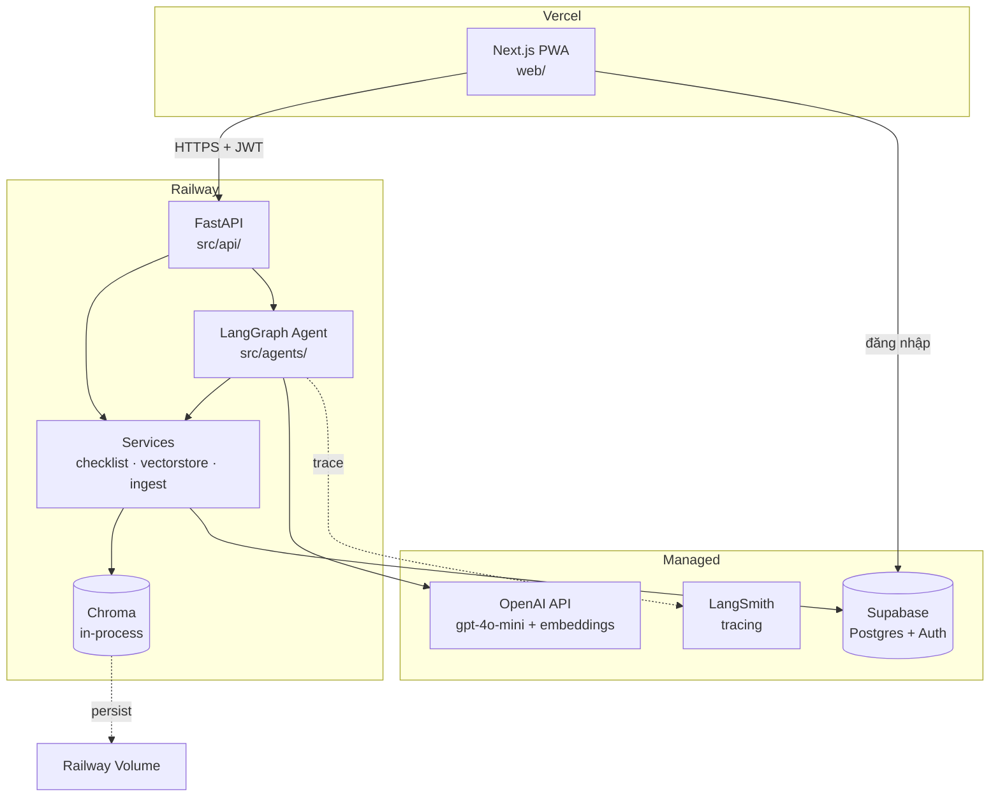
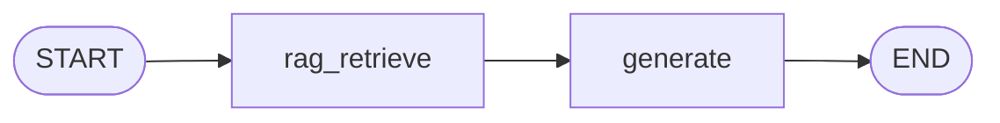
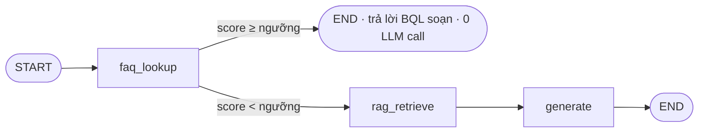
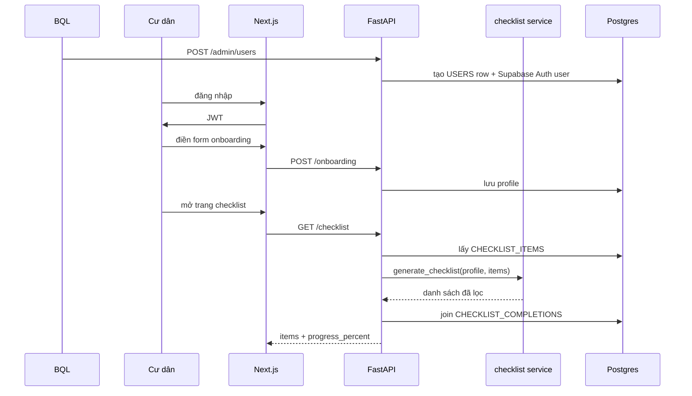
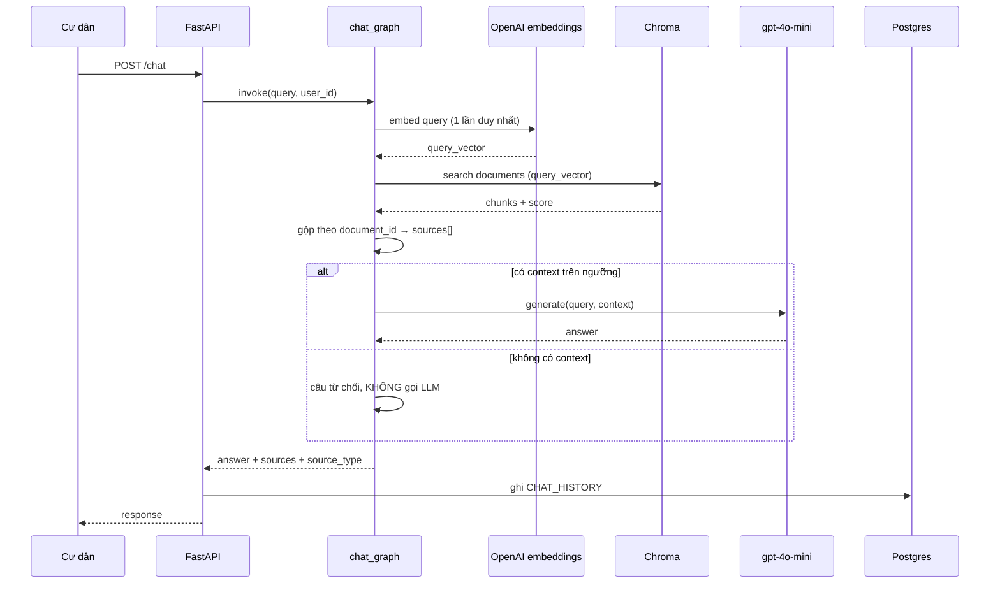
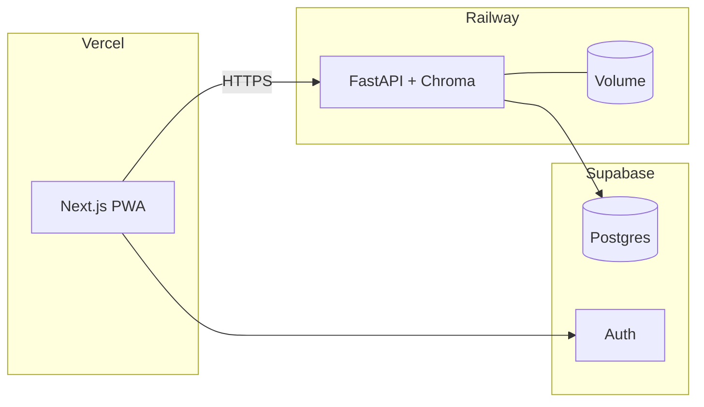

# Architecture — MoveInMate

> Kiến trúc hệ thống cho Phase 1. Nguồn quyết định về scope và persona: [`PROJECT_CHARTER.md`](./PROJECT_CHARTER.md).
> Nhãn **`[GATE 2]`** = bắt buộc xong trước 12/08. Nhãn **`[W4]`** = vẫn thuộc Phase 1 nhưng làm sau.

**Cập nhật:** 06/08/2026

---

## 1. System Overview

MoveInMate là web app dạng PWA giúp cư dân mới hoàn thành thủ tục onboarding tại Vinhomes Smart City. Hệ thống gồm ba tầng: giao diện Next.js trên Vercel, API FastAPI trên Railway, và tầng dữ liệu Supabase Postgres kết hợp Chroma vector store.

Hai năng lực cốt lõi được xử lý bằng hai cơ chế khác nhau có chủ đích: **checklist cá nhân hóa** dùng rule engine tất định (không LLM), còn **hỏi đáp thủ tục** dùng LangGraph agent với RAG. Ranh giới này là quyết định kiến trúc trung tâm — xem mục 7.

## 2. Architecture Diagram



**Vì sao Chroma chạy in-process:** stack bắt buộc theo đề bài. Vì filesystem của Railway là ephemeral, embeddings được ghi vào **Railway Volume** mount tại `chroma_persist_dir` — nếu không, mỗi lần deploy là mất toàn bộ vector và phải embed lại (tốn phí API, đi ngược ràng buộc "tối ưu chi phí").

## 3. Components

### 3.1 Frontend — Next.js PWA (`web/`)

- **Vai trò:** giao diện cư dân (mobile-first) và giao diện BQL (desktop)
- **PWA:** web app manifest + service worker + bộ icon → cài được vào màn hình chính, mở toàn màn hình. *Cách khai báo manifest tuỳ phiên bản Next.js đang dùng — kiểm tra tài liệu trong `node_modules/next/dist/docs/` trước khi code, xem `web/AGENTS.md`*
- **Giới hạn có chủ đích:** chỉ cache vỏ app và asset tĩnh. **Không** làm offline data sync — chat và checklist đều cần mạng, và sync offline là khối lượng lớn không nằm trong yêu cầu nào của đề bài
- **State:** React state cục bộ + fetch trực tiếp; không thêm thư viện state management cho quy mô này
- **Auth:** lấy JWT trực tiếp từ Supabase client, gắn vào header mọi request tới API

### 3.2 Backend — FastAPI (`src/api/`)

Routes ánh xạ 1-1 với user story, xem bảng hợp đồng API ở mục 4.3.

- **Xác thực:** dependency `get_current_user` verify JWT của Supabase, trả về user kèm `role`
- **Phân quyền:** route `/admin/*` thêm dependency kiểm tra `role == "admin"`. `role` lưu ở bảng `USERS`, tra DB mỗi request admin (một query, chấp nhận được)
- **Validation:** Pydantic schemas trong `models/schemas.py` — đây là hợp đồng API với FE, không được đổi ngầm

### 3.3 Rule Engine — `src/services/checklist.py`

Hàm thuần, không phụ thuộc DB hay LangGraph:

```python
def matches(profile: dict, conditions: dict) -> bool:
    """Item hiển thị nếu MỌI cặp key:value trong conditions khớp profile.
    conditions rỗng ({}) → luôn khớp."""

def generate_checklist(profile: dict, items: list) -> list:
    """Lọc danh sách item theo profile cư dân."""
```

- So khớp AND, exact-match trên `conditions` (JSONB). Với `amenity_packages` (multi-select), giá trị đơn hiểu là "nằm trong danh sách"
- **Không hỗ trợ OR hay so sánh khoảng** — chấp nhận có ý thức. Nếu phát sinh nhu cầu OR, thêm hai dòng dữ liệu thay vì làm engine phức tạp hơn
- Validate key của `conditions` phải khớp field hợp lệ của `USERS` khi seed, chặn lỗi gõ nhầm khiến item âm thầm không bao giờ khớp

**`item_type` không tham gia lọc** — nó không phải điều kiện, mà là nhãn quyết định cách hiển thị và hành vi:

| `item_type` | Hiển thị | Tick hoàn thành | HITL (Phase 2) | Nguồn trích dẫn |
|---|---|---|---|---|
| `bql_actionable` | Mục thủ tục bình thường | Có | Có | Tài liệu nội bộ BQL |
| `third_party_info` | Có nhãn "quy trình bên ngoài BQL" | Có — cư dân tự xác nhận | **Không** | Quy định pháp luật công khai |

Response của `GET /checklist` phải trả kèm `item_type` để FE hiển thị đúng — cư dân cần biết mục nào BQL xử lý được và mục nào phải tự làm ở cơ quan khác.

### 3.4 AI Agent — LangGraph (`src/agents/`)

**Chỉ một graph: `chat_graph`.** Checklist không đi qua LangGraph.

**Hình dạng graph ở `[GATE 2]`** — chỉ hai node, không có nhánh FAQ:



**Hình dạng graph sau khi bổ sung FAQ ở `[W4]`:**



| Node | Đọc state | Ghi state | Trách nhiệm |
|---|---|---|---|
| `faq_lookup` **`[W4]`** | `query` | `query_vector`, `faq_answer`, `faq_score`, `source_type` | Embed query → search collection `faq` → so ngưỡng |
| `rag_retrieve` **`[GATE 2]`** | `query`, `query_vector?` | `query_vector`, `retrieved[]`, `sources[]` | Search collection `documents`, top-k |
| `generate` **`[GATE 2]`** | `query`, `retrieved[]` | `answer` | LLM chỉ viết văn xuôi từ context |

**Ai embed query:** ở `[GATE 2]` graph chỉ có `rag_retrieve` → node này tự embed. Khi bổ sung `faq_lookup` ở `[W4]`, node đó embed trước và ghi `query_vector` vào state; `rag_retrieve` thấy `query_vector` đã có thì **dùng lại, không embed lần hai**. Nhờ vậy mỗi câu hỏi luôn chỉ tốn đúng một lần embedding ở cả hai giai đoạn.

**Hai bảo đảm kỹ thuật quan trọng:**

1. **`sources[]` là output tất định của `rag_retrieve`**, không phải do LLM sinh ra. Yêu cầu "trích tài liệu" của đề bài do đó là bảo đảm kỹ thuật, không phụ thuộc vào việc prompt có được tuân thủ hay không. Sources được gộp theo `document_id` trước khi trả về, tránh lặp cùng một tài liệu nhiều lần.

2. **Guard chống bịa thông tin:** khi `retrieved` rỗng hoặc mọi score dưới ngưỡng, `generate` **không gọi LLM** mà trả câu từ chối kèm hướng dẫn liên hệ BQL. Đây là ràng buộc trong code, không phải lời dặn trong prompt.

**Giới hạn Phase 1: single-turn.** Mỗi câu hỏi độc lập, không truyền lịch sử hội thoại vào agent. Hỏi nối tiếp kiểu "còn thẻ xe thì sao?" sẽ mất ngữ cảnh. Đây là quyết định có ý thức để tiết kiệm ~6-8h; làm đúng cần thêm bước viết lại câu hỏi theo ngữ cảnh. Cân nhắc ở Phase 2.

**Trace:** LangSmith bật qua biến môi trường (deliverable #4 của BTC).

### 3.5 Vector Store — Chroma (`src/services/vectorstore.py`, `ingest.py`)

Hai collection:

| Collection | Nội dung | Giai đoạn |
|---|---|---|
| `documents` | Chunk từ tài liệu KB | `[GATE 2]` |
| `faq` | Câu hỏi thường gặp do BQL soạn | `[W4]` |

**Metadata mỗi chunk** — gắn trực tiếp với quyết định phạm vi quy trình trong charter:

```json
{
  "document_id": 12,
  "title": "Quy trình cấp thẻ cư dân",
  "source_type": "bql_internal"
}
```

`source_type` nhận `bql_internal` (tài liệu nội bộ BQL) hoặc `public_regulation` (quy định pháp luật công khai). Nhờ đó câu trả lời phân biệt được nguồn, đúng ràng buộc: thủ tục thuộc bên thứ ba chỉ được hướng dẫn theo quy định công khai, không mạo nhận là quy trình BQL.

**Chiến lược chia nhỏ tài liệu (chunking)** — đây là yếu tố quyết định chất lượng retrieval, quan trọng hơn cấu trúc graph:

- Ưu tiên cắt theo mục/tiêu đề nếu tài liệu có cấu trúc rõ
- Không có cấu trúc: ~500 token, overlap 50
- **Bắt buộc kiểm tra thủ công** 10 câu hỏi thật xem retrieval có lấy đúng đoạn không, trước khi tin vào pipeline. Chunk sai làm hệ thống trông như "AI kém" dù code đúng hoàn toàn

**Nạp tài liệu:** script CLI nạp hàng loạt (dùng cho mốc 17/08) + upload đơn lẻ chạy đồng bộ qua giao diện BQL, có giới hạn dung lượng file. **Không dùng `BackgroundTasks`** — task chạy nền mất im lặng khi container restart, là chế độ hỏng khó chẩn đoán.

### 3.6 Database — Supabase Postgres (`src/models/db.py`)

| Bảng | Vai trò |
|---|---|
| `USERS` | Hồ sơ cư dân + `auth_user_id` trỏ Supabase Auth. Không lưu password |
| `CHECKLIST_ITEMS` | Template thủ tục, có `conditions` (JSONB) và `item_type` |
| `CHECKLIST_COMPLETIONS` | Chỉ lưu mục **đã hoàn thành**: `(user_id, checklist_item_id, completed_at)` |
| `CHAT_HISTORY` | Lịch sử hỏi đáp + `source_type` + `sources` (JSONB) |
| `FAQ` | Câu hỏi thường gặp do BQL quản lý |
| `DOCUMENTS` | Metadata tài liệu + `ingest_status` |
| `APPLICATIONS` | Hồ sơ duyệt — **Phase 2**, chưa migrate ở Phase 1 |

Chi tiết field: xem mục 6 của [`PROJECT_CHARTER.md`](./PROJECT_CHARTER.md).

**Migration bằng Alembic + script seed** cho `CHECKLIST_ITEMS`. Không có seed thì mỗi thành viên một database khác nhau, demo chỉ chạy trên máy người viết.

## 4. Data Flow

### 4.1 Onboarding → Checklist (không qua LLM)



**Lọc trực tiếp, không chốt cứng danh sách.** Checklist được tính lại mỗi lần gọi thay vì ghi sẵn lúc onboarding. Ba lợi ích:

- BQL cập nhật thủ tục thì cư dân cũ **thấy ngay**, không cần logic đồng bộ
- Cư dân sửa hồ sơ (mua xe sau khi dọn vào) thì checklist tự cập nhật, không cần logic gộp dễ sai
- Không phát sinh câu hỏi khó "mục đã tick nhưng không còn khớp điều kiện thì xử lý sao"

Chi phí: lọc 20-30 mục mỗi request, không đáng kể.

### 4.2 Hỏi đáp



**Lưu ý:** embedding là lời gọi tới OpenAI, **không phải** Chroma tự embed. Cấu hình Chroma phải tắt embedding function mặc định của nó (mô hình local), nếu không sẽ dùng nhầm mô hình khác lúc index và lúc query — vector không cùng không gian, retrieval trả về rác.

### 4.3 Hợp đồng API — ranh giới BE ↔ FE

| Method | Endpoint | US | Giai đoạn |
|---|---|---|---|
| POST | `/api/v1/onboarding` | US-02 | `[GATE 2]` |
| GET | `/api/v1/checklist` | US-04 | `[GATE 2]` |
| PATCH | `/api/v1/checklist/{id}` | US-04 | `[GATE 2]` |
| POST | `/api/v1/chat` | US-05 | `[GATE 2]` |
| GET | `/api/v1/profile` · PATCH | US-06 | `[GATE 2]` |
| GET | `/api/v1/chat/history` | US-07 | `[GATE 2]` |
| POST | `/api/v1/admin/users` | US-00 | `[GATE 2]` |
| POST | `/api/v1/admin/documents` | US-08 | `[W4]` |
| CRUD | `/api/v1/admin/faq` | US-09 | `[W4]` |
| GET | `/api/v1/admin/dashboard` | US-12-mini | `[W4]` |

**Cư dân chưa hoàn thành onboarding:** `GET /profile` trả `onboarding_completed_at = null`, FE dựa vào đó chuyển hướng sang `/onboarding`. Quy ước này phải nằm trong hợp đồng, không để mỗi bên tự đoán.

## 5. Error Handling

Phân biệt rõ "lỗi hệ thống" và "không có dữ liệu" — nhầm hai loại này làm hệ thống hoặc bịa thông tin, hoặc báo lỗi sai chỗ:

| Tình huống | Phân loại | Hành vi |
|---|---|---|
| Chroma rỗng hoặc score dưới ngưỡng | Không phải lỗi | HTTP 200, câu từ chối kèm hướng dẫn liên hệ BQL |
| Gọi embedding thất bại | Lỗi hạ tầng | HTTP 503, không ghi `CHAT_HISTORY` |
| LLM `generate` lỗi/timeout | Lỗi một phần | Trả `sources[]` đã lấy được kèm ghi chú chưa tạo được tóm tắt |
| JWT sai/hết hạn | Lỗi xác thực | HTTP 401, FE chuyển về đăng nhập |
| Chưa onboarding | Không phải lỗi | `onboarding_completed_at = null` |

**Bắt buộc:** timeout tường minh cho mọi lời gọi ra ngoài (OpenAI, Supabase). Không timeout thì request treo vô hạn — lỗi kinh điển lúc demo. Không dùng `except:` trần; bắt đúng loại exception theo quy ước code style của dự án.

## 6. Testing

```
tests/
├── test_services/test_checklist.py   ← ưu tiên cao nhất
├── test_agents/test_chat_graph.py    ← mock vectorstore + LLM
└── test_api/test_routes.py           ← test DB riêng
```

**`test_checklist.py` là nơi đầu tư đáng giá nhất.** Hàm thuần, không cần mock, và nó bảo vệ đúng thứ tạo nên giá trị sản phẩm: cá nhân hóa. Checklist sai cho một persona thì luận điểm sản phẩm sụp, mà lỗi loại này rất khó phát hiện bằng mắt. Viết dạng bảng: mỗi tổ hợp `ownership_type × has_car × amenity_packages` kỳ vọng ra đúng danh sách nào.

**Test agent kiểm tra logic điều hướng, không kiểm tra chất lượng văn bản LLM:** trúng ngưỡng có bỏ qua LLM không, không có context có từ chối không, sources có gộp trùng không.

## 7. Design Decisions

| Quyết định | Lựa chọn | Lý do |
|---|---|---|
| Phân loại cư dân | Rule-based, **không LLM** | Persona là tập hữu hạn thuộc tính thu qua form có cấu trúc. Dùng LLM ở đây vừa tốn kém vừa kém tin cậy hơn |
| Vị trí rule engine | Service thuần, **không phải node LangGraph** | Một graph một node bọc hàm thuần là thừa. LangGraph dành cho chỗ cần quyết định thật: hỏi đáp và định tuyến ticket (Phase 2) |
| Nguồn của `sources[]` | Từ `rag_retrieve`, **không hỏi LLM** | Bắt LLM tự liệt kê nguồn là nơi phần lớn hệ RAG thất bại — bịa tên tài liệu, sai format |
| Lưu checklist | Lọc trực tiếp, chỉ lưu mục đã xong | BQL cập nhật thủ tục là cư dân cũ thấy ngay; không cần logic đồng bộ hay gộp |
| Số lần embed mỗi câu hỏi | Một lần, dùng lại vector | Embed hai lần cho cùng một câu là lãng phí chi phí và latency |
| Persist vector store | Railway Volume | Filesystem Railway là ephemeral; không có volume thì mỗi lần deploy phải embed lại toàn bộ KB |
| Ingest tài liệu | Đồng bộ + script CLI | `BackgroundTasks` hỏng im lặng khi container restart, khó chẩn đoán |
| Hội thoại | Single-turn ở Phase 1 | Multi-turn cần bước viết lại câu hỏi theo ngữ cảnh, ~6-8h. Cân nhắc Phase 2 |
| Nhánh FAQ | Thiết kế sẵn, code ở `[W4]` | Chi phí thật nằm ở hiệu chỉnh ngưỡng, cần dữ liệu thật. RAG đơn thuần đã đủ thoả mãn yêu cầu đề bài |

## 8. Deployment



**Biến môi trường:**

| Nơi | Biến |
|---|---|
| Vercel | `NEXT_PUBLIC_API_URL`, `NEXT_PUBLIC_SUPABASE_URL`, `NEXT_PUBLIC_SUPABASE_ANON_KEY` |
| Railway | `OPENAI_API_KEY`, `DATABASE_URL`, `SUPABASE_URL`, `SUPABASE_SERVICE_KEY`, `SUPABASE_JWT_SECRET`, `CHROMA_PERSIST_DIR`, `FAQ_SIMILARITY_THRESHOLD`, `RAG_TOP_K`, `CORS_ORIGINS`, `LANGCHAIN_TRACING_V2`, `LANGCHAIN_API_KEY`, `LANGCHAIN_PROJECT` |

**Ràng buộc vận hành:** Chroma chạy trong cùng tiến trình FastAPI nên hệ thống chỉ chạy **một instance**. Scale ngang sẽ khiến mỗi instance có một bản vector store riêng biệt — không bật auto-scale.

**CI/CD:** `.github/workflows/ci.yml` chạy ruff + pytest. Code không pass ruff bị reject.

## 9. Security

Đề bài đặt ràng buộc tường minh: *"bảo mật giấy tờ & thông tin cá nhân cư dân mới"*. Các quy tắc dưới đây phục vụ trực tiếp ràng buộc đó.

- Không commit khoá; toàn bộ secret qua biến môi trường
- Supabase Auth là nguồn xác thực duy nhất — hệ thống không tự lưu password
- Validate input bằng Pydantic ở mọi endpoint
- Route `/admin/*` kiểm tra `role == "admin"` phía server, không tin phía client
- CORS chỉ mở cho domain Vercel của dự án
- Truy vấn dữ liệu cá nhân (`CHAT_HISTORY`, `CHECKLIST_COMPLETIONS`, hồ sơ) phải lọc theo `user_id` **ngay trong câu truy vấn**, không lấy hết rồi lọc ở tầng ứng dụng hay phía client

**Quy tắc kiến trúc: không bao giờ đưa dữ liệu cá nhân cư dân vào vector store.** Chroma không có cơ chế phân quyền theo người dùng — mọi thứ đã index thì bất kỳ ai hỏi đúng câu đều truy xuất được. Vector store chỉ chứa tài liệu thủ tục dùng chung. Khi Phase 2 làm `APPLICATIONS` (CCCD, hợp đồng), tuyệt đối không embed các tài liệu này để "tìm kiếm cho tiện".

**Kiểm soát chi phí:** đặt `max_tokens` cho mọi lời gọi LLM và giới hạn số câu hỏi mỗi người dùng mỗi ngày. URL demo là công khai; một vòng lặp vô ý ở FE hoặc người lạ truy cập có thể đốt hết credit OpenAI trước Demo Day.

## 10. Việc cần sửa trong code hiện có

| File | Việc |
|---|---|
| `src/config.py` | `database_url` đang mặc định SQLite → trỏ Supabase Postgres; thêm biến Supabase, ngưỡng FAQ, `rag_top_k`, LangSmith |
| `src/models/db.py` | Chưa tồn tại — tạo model SQLAlchemy |
| `src/agents/nodes/example_node.py` | Code mẫu của template — thay bằng node thật |
| `src/agents/tools/example_tool.py` | Code mẫu — xoá nếu Phase 1 không dùng tool |
| `src/agents/state.py` | `AgentState` chung → `ChatState` với các field ở mục 3.4 |
| `web/app/login/page.tsx` | Đã kiểm tra: **không** có luồng tự đăng ký (đúng quyết định BQL cấp tài khoản). Nhưng nút "Đăng nhập" hiện là `<Link>` tĩnh sang `/dashboard` — cần nối Supabase Auth thật |
| `web/` | Thiếu trang `/onboarding` — mắt xích bắt buộc để checklist hoạt động |
| `web/` | Toàn bộ trang hiện dùng dữ liệu mock, chưa gọi API nào |

## 11. Rủi ro kỹ thuật đã biết

| Rủi ro | Mức | Giảm thiểu |
|---|---|---|
| Chất lượng chunking kém → retrieval trả về đoạn sai | Cao — hỏng thầm lặng | Kiểm tra thủ công 10 câu hỏi trước khi tin pipeline |
| Xác thực JWT Supabase cấu hình sai | Cao — chặn cả đội | Giới hạn 2h thử; chưa xong thì tạm dùng `supabase-py` gọi `auth.get_user(jwt)` |
| Chưa có tài liệu KB để demo ở GATE 2 (cổng dữ liệu là 13/08, **sau** GATE 2) | Cao | Dùng Thông tư 02/2016/TT-BXD — công khai, tải được ngay, gắn `source_type: public_regulation` |
| Ngưỡng FAQ chưa hiệu chỉnh → không bao giờ trúng hoặc trúng sai | Trung bình | Để trong config; hiệu chỉnh bằng ~20 câu hỏi thật ở W4 |
| Chroma client là sync, node LangGraph là async → chẹn event loop | Trung bình | Bọc `run_in_threadpool` |
