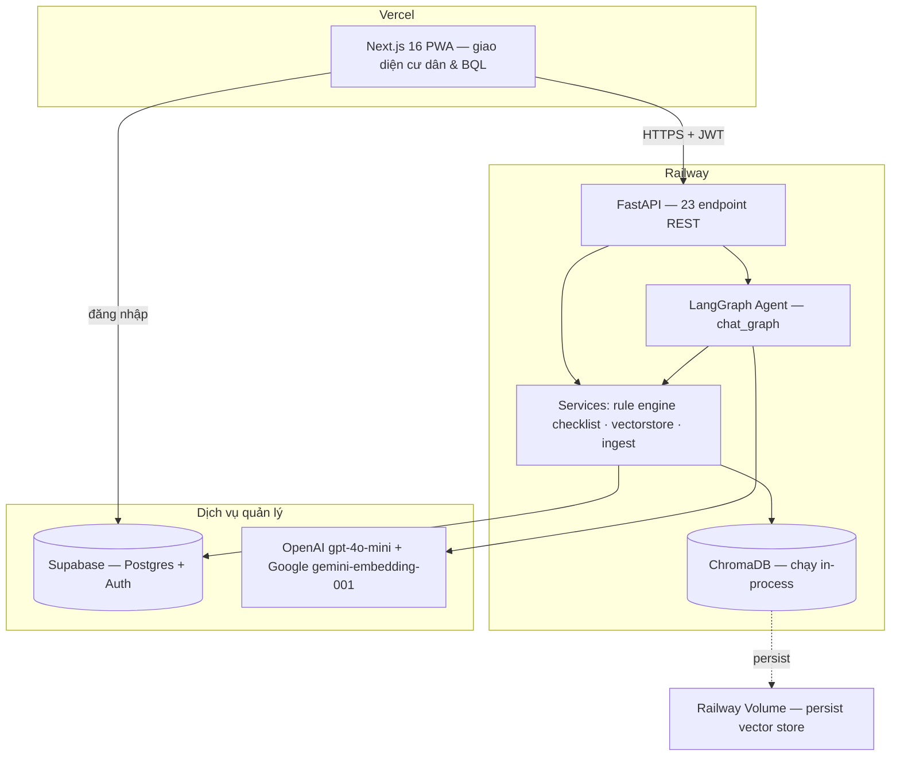

# MoveInMate — Bài toán, Giải pháp kỹ thuật, Tính khả thi và Hướng phát triển

*Tài liệu tổng hợp từ `PROJECT_CHARTER.md`, `architecture_diagram.md`, `PRD.md`, `OPERATIONS.md` và `README.md` của dự án. Cập nhật theo trạng thái mã nguồn tính đến 19/08/2026.*

---

## 1. Bài toán

### 1.1 Bối cảnh và đề bài gốc

Cư dân mới nhận bàn giao căn hộ tại các dự án bất động sản lớn phải tự hoàn tất hàng loạt thủ tục rời rạc: đăng ký thẻ cư dân, thẻ xe, internet, ký nội quy, kích hoạt tiện ích — mỗi thủ tục một nơi nộp, một bộ giấy tờ, một thời hạn riêng. Không có ai đưa cho họ một danh sách đúng với hoàn cảnh cụ thể của mình, nên hai hệ quả xảy ra song song:

- **Cư dân** choáng ngợp, không biết bắt đầu từ đâu, dễ làm sai thứ tự hoặc bỏ sót thủ tục.
- **Ban quản lý (BQL)** phải trả lời lặp đi lặp lại cùng những câu hỏi — đăng ký ở đâu, cần giấy tờ gì, hồ sơ đến đâu rồi — có thể lên tới hàng trăm lượt hỏi mỗi ngày ở các dự án lớn, kéo theo chi phí vận hành ẩn: nhân sự CSKH xử lý thủ công, nhập liệu sai sót, cư dân gọi điện hỏi lại nhiều lần.

Đề bài gốc của ban tổ chức (BTC) yêu cầu một AI Agent dẫn dắt onboarding **cá nhân hoá**, lập checklist thủ tục **theo tình huống từng hộ**, hướng dẫn từng bước có trích dẫn tài liệu, và theo dõi tiến độ hoàn tất — kèm ràng buộc bắt buộc: có sự xác nhận của con người (HITL) cho các thủ tục cần BQL duyệt hồ sơ/giấy tờ, bảo mật thông tin cá nhân cư dân, chính xác trong hướng dẫn thủ tục theo từng khu, và tối ưu chi phí vận hành nhiều bước.

**Điểm mấu chốt:** "cá nhân hoá" và "theo tình huống từng hộ" xuất hiện ngay trong đề bài chính thức — đây là yêu cầu chấm điểm bắt buộc, không phải một lựa chọn kiến trúc tuỳ chọn của đội. Một hệ thống chỉ đưa ra danh sách thủ tục chung chung sẽ không đáp ứng đúng đề tài, dù thực thi có tốt đến đâu.

### 1.2 Vì sao các giải pháp hiện có chưa lấp được khoảng trống

Vinhomes Resident — ứng dụng hiện có của cư dân — xử lý đặt tiện ích, thanh toán phí, gửi phản ánh: phục vụ cư dân **đã ổn định**. Hồ sơ giấy tờ và thẻ ra/vào vẫn phải làm việc trực tiếp, thủ công qua BQL. MoveInMate nhắm đúng vào khoảng trống **4–6 tuần đầu tiên**, giai đoạn cư dân chưa biết mình cần làm gì và ứng dụng sẵn có không phục vụ.

### 1.3 Người dùng và phạm vi

| Vai trò | Mô tả |
|---|---|
| **Khách hàng (buyer)** | Ban quản lý chung cư — đơn vị triển khai và trả phí. Mọi ưu tiên tính năng phục vụ đúng nhu cầu của BQL trước (giảm tải trả lời lặp lại, theo dõi tiến độ cư dân), cư dân là người thụ hưởng gián tiếp. |
| **Người dùng cuối** | Cư dân mới, được BQL cấp tài khoản (không tự đăng ký công khai). Persona chính là **chủ căn hộ**; có nhánh riêng cho **người thuê** với bộ thủ tục khác (cần uỷ quyền, phải đăng ký tạm trú). |
| **Phạm vi địa lý** | Vinhomes Smart City — một khu cụ thể, không triển khai đa khu ở giai đoạn này. |
| **Phạm vi quy trình** | Thủ tục thuộc BQL (thẻ cư dân, thẻ xe, tiện ích...) được hỗ trợ đầy đủ: theo dõi, có thể nộp hồ sơ online, trích nguồn từ tài liệu nội bộ. Thủ tục thuộc bên thứ ba (ví dụ đăng ký tạm trú qua công an phường) chỉ được **hướng dẫn tham khảo** theo quy định pháp luật công khai, không tracking, không nhận thay mặt BQL xử lý — tránh mạo nhận đó là quy trình của BQL. |

### 1.4 Bốn nguyên tắc trải nghiệm chi phối thiết kế

Khi các quyết định thiết kế mâu thuẫn nhau, thứ tự ưu tiên sau quyết định lựa chọn nào thắng:

1. **Thà nói không biết còn hơn hướng dẫn sai** — thủ tục hành chính sai khiến cư dân phải đi lại lần hai; trợ lý phải từ chối khi không có căn cứ, và cơ chế từ chối nằm **trong code**, không phải chỉ dặn dò trong prompt.
2. **Minh bạch nguồn, kể cả khi nguồn là dữ liệu mô phỏng** — mỗi câu trả lời hiện nhãn phân loại nguồn; dữ liệu nhóm tự dựng cho demo mang nhãn "Quy trình mô phỏng (dữ liệu demo)", không giấu.
3. **Gỡ sự mơ hồ trước, tạo động lực sau** — người dùng ngại làm thủ tục vì thiếu thông tin (mang gì, mất bao lâu, đi đâu), không phải vì thiếu động lực; phần thưởng/gamification đứng sau, không thay thế ba câu trả lời cốt lõi này.
4. **Không hứa thay mặt Ban quản lý** — phần thưởng chỉ là thứ sản phẩm tự trao được (huy hiệu, cột mốc); không hứa ưu đãi tiền, vì đó là quyền của BQL.

---

## 2. Giải pháp kỹ thuật

### 2.1 Kiến trúc tổng quan

MoveInMate là một web app dạng PWA (Progressive Web App), gồm ba tầng triển khai độc lập:



**Quyết định kiến trúc trung tâm:** hai năng lực cốt lõi được xử lý bằng hai cơ chế khác nhau, có chủ đích:

- **Checklist cá nhân hoá** → rule engine tất định, **không dùng LLM**.
- **Hỏi đáp thủ tục** → LangGraph agent kết hợp RAG (Retrieval-Augmented Generation).

Lý do tách bạch: phân loại cư dân theo hồ sơ (chủ hộ/người thuê, có xe, gói tiện ích) là bài toán trên tập thuộc tính hữu hạn, thu qua form có cấu trúc — dùng LLM ở đây vừa tốn kém vừa kém tin cậy hơn một quy tắc so khớp đơn giản. Ngược lại, trả lời câu hỏi tự do bằng ngôn ngữ tự nhiên là bài toán thực sự cần mô hình ngôn ngữ.

### 2.2 Rule engine — checklist cá nhân hoá

Nằm ở tầng service thuần (`src/services/checklist.py`), không phụ thuộc DB hay LangGraph, không phải một node trong graph (tránh việc bọc một hàm thuần thành node LangGraph một cách thừa thãi):

```python
def matches(profile: dict, conditions: dict) -> bool:
    """Item hiển thị nếu MỌI cặp key:value trong conditions khớp profile.
    conditions rỗng ({}) → luôn khớp."""

def generate_checklist(profile: dict, items: list) -> list:
    """Lọc danh sách item theo profile cư dân."""
```

- So khớp kiểu AND, exact-match trên trường `conditions` (JSONB). Với thuộc tính multi-select (`amenity_packages`), một giá trị đơn được hiểu là "nằm trong danh sách đã chọn".
- **Không hỗ trợ OR hay so sánh khoảng** — đây là giới hạn được chấp nhận có ý thức; khi phát sinh nhu cầu OR thì thêm dòng dữ liệu thay vì làm engine phức tạp hơn.
- **Lọc trực tiếp tại thời điểm truy vấn, không chốt cứng checklist lúc onboarding.** Mỗi lần gọi `GET /checklist`, hệ thống lọc lại `CHECKLIST_ITEMS` theo hồ sơ hiện tại rồi join với bảng chỉ lưu các mục **đã hoàn thành**. Cách này mang lại ba lợi ích: BQL cập nhật thủ tục thì cư dân cũ thấy ngay lập tức; cư dân sửa hồ sơ (ví dụ mua xe sau khi dọn vào) thì checklist tự cập nhật mà không cần logic gộp dễ sai; và không phát sinh câu hỏi khó "mục đã tick nhưng không còn khớp điều kiện thì xử lý sao".
- Mỗi mục checklist còn mang nhãn `item_type` (`bql_actionable` hoặc `third_party_info`) quyết định cách hiển thị, có cho phép nộp hồ sơ online hay không, và nguồn trích dẫn — đây là cơ chế hiện thực hoá ràng buộc "không mạo nhận quy trình bên thứ ba là của BQL" nêu ở mục 1.3.

### 2.3 AI Agent — LangGraph + RAG cho hỏi đáp thủ tục

Toàn hệ thống chỉ có một graph (`chat_graph`), với luồng thực tế đang chạy:


| Node | Vai trò |
|---|---|
| `rewrite_query` | Chỉ chạy khi hội thoại đã có lịch sử — dùng LLM viết lại câu hỏi mơ hồ (ví dụ "còn thẻ xe thì sao?") thành một câu hỏi độc lập ngữ cảnh, dựa trên vài lượt gần nhất của đúng hội thoại đang mở. Đây là cơ chế cho phép hỏi đáp **multi-turn**. |
| `rag_retrieve` | Embed câu hỏi (nếu chưa có vector), tìm kiếm trong ChromaDB, trả về các đoạn tài liệu liên quan kèm điểm số, gộp theo `document_id` để tránh trích trùng một tài liệu. |
| `generate` | Chỉ khi có ngữ cảnh vượt ngưỡng, LLM mới được gọi để viết câu trả lời **dựa trên context đã truy xuất** — không được tự do sáng tác. |

**Hai bảo đảm kỹ thuật là xương sống của giải pháp:**

1. **`sources[]` là output tất định của bước truy xuất, không phải do LLM tự liệt kê.** Yêu cầu "trả lời có trích nguồn" của đề bài vì vậy là một bảo đảm ở tầng code, không phụ thuộc việc LLM có tuân thủ prompt hay không — đây là điểm mà phần lớn hệ thống RAG khác thất bại (LLM tự bịa tên tài liệu, sai định dạng trích dẫn).
2. **Guard chống bịa thông tin nằm trong code.** Khi không tìm được đoạn tài liệu nào vượt ngưỡng liên quan, node `generate` **không gọi LLM** mà trả thẳng câu từ chối kèm hướng dẫn liên hệ BQL. Đây không phải một chỉ dẫn "hãy trung thực" trong system prompt — model không có cơ hội bịa vì đường gọi tới nó bị chặn từ trước.

**Nhận diện nguồn tài liệu:** mỗi đoạn văn bản trong ChromaDB mang metadata `source_type` với bốn giá trị — `bql_internal` (tài liệu nội bộ BQL), `public_regulation` (văn bản pháp quy còn hiệu lực), `unofficial_web` (trang tham khảo chưa xác minh), và `synthetic_demo` (quy trình nhóm tự dựng cho mục đích trình diễn, luôn hiển thị nhãn "Quy trình mô phỏng" ở giao diện). Cơ chế này cho phép câu trả lời phân biệt rạch ròi giữa "quy trình chính thức của BQL" và "hướng dẫn tham khảo", đúng ràng buộc bảo mật/chính xác của đề bài.

### 2.4 Dữ liệu và mô hình lưu trữ

| Bảng (Postgres qua Supabase) | Vai trò chính |
|---|---|
| `USERS` | Hồ sơ cư dân, gắn với Supabase Auth qua `auth_user_id` — hệ thống không tự lưu mật khẩu. Có `account_status` (active/locked) để BQL khoá tài khoản khi cần. |
| `CHECKLIST_ITEMS` | Template thủ tục dùng chung, mang `conditions` (JSONB) và `item_type`. |
| `CHECKLIST_COMPLETIONS` | Chỉ lưu các mục **đã hoàn thành** — thiết kế tối giản có chủ đích, tránh logic đồng bộ phức tạp. |
| `CHAT_HISTORY` | Lịch sử hỏi đáp, kèm `answer_source` (faq/rag/no_context) và `sources` (JSONB); nội dung câu hỏi đã được che thông tin cá nhân (PII masking) trước khi lưu. |
| `APPLICATIONS` / `APPLICATION_ATTACHMENTS` | Hồ sơ cư dân nộp trực tuyến cho một mục checklist cụ thể, kèm ảnh/PDF minh chứng (lưu ở Supabase Storage riêng, chỉ đọc qua signed URL hết hạn ngắn) và quy trình duyệt 6 trạng thái phía BQL — đây chính là lớp HITL mà đề bài yêu cầu. |
| `DOCUMENTS` | Metadata tài liệu do BQL nạp vào kho tri thức, theo dõi trạng thái nhúng vector qua `embed_status` (pending/processing/ready/failed) chạy nền, không chặn giao diện. |

Vector store ChromaDB được lưu bền trên Railway Volume (không phải filesystem tạm thời của container), tránh việc mỗi lần triển khai lại phải nhúng toàn bộ kho tri thức từ đầu — vừa tốn chi phí gọi API vừa mất thời gian.

### 2.5 Xác thực, phân quyền và bảo mật

Đề bài đặt ràng buộc tường minh "bảo mật giấy tờ & thông tin cá nhân cư dân mới". Các cơ chế sau phục vụ trực tiếp ràng buộc đó:

- **Xác thực:** Supabase Auth là nguồn xác thực duy nhất, ký token chuẩn ES256 kèm xác minh qua JWKS; hệ thống không tự lưu mật khẩu.
- **Phân quyền:** mọi route `/admin/*` kiểm tra vai trò `admin` ngay phía server, không tin dữ liệu phía client.
- **Cách ly dữ liệu cá nhân:** mọi truy vấn dữ liệu riêng tư (lịch sử chat, tiến độ checklist, hồ sơ) lọc theo `user_id` ngay trong câu truy vấn — không lấy toàn bộ rồi lọc ở tầng ứng dụng.
- **Không đưa dữ liệu cá nhân vào vector store** — đây là quy tắc kiến trúc cứng, vì ChromaDB không có cơ chế phân quyền theo người dùng: bất kỳ ai hỏi đúng câu cũng truy xuất được nội dung đã nhúng.
- **Che thông tin cá nhân (PII masking)** trước khi ghi vào lịch sử chat — cư dân có thể gõ số CCCD, số điện thoại vào ô chat.
- **Giới hạn tần suất (rate limiting)** riêng cho các endpoint tốn tiền (gọi LLM, gọi embedding, tải tệp) — chặn việc một client gọi liên tục làm cạn hạn mức API trả phí, trong khi các endpoint chỉ đọc không bị giới hạn.

### 2.6 Vận hành và độ tin cậy

| Cơ chế | Trạng thái |
|---|---|
| Trích nguồn tất định, không do LLM tự sinh | Đã triển khai |
| Xác thực JWT + phân quyền phía server | Đã triển khai |
| Giới hạn độ dài đầu vào, trần token đầu ra, timeout gọi LLM | Đã triển khai |
| Kiểm tra sức khoẻ hệ thống thật (`/health/deep` — kiểm cả DB lẫn vector store, trả lỗi rõ ràng nếu một trong hai chết) | Đã triển khai |
| Giới hạn tần suất theo IP cho endpoint tốn phí | Đã triển khai |
| Log có cấu trúc kèm mã định danh request để truy vết một request qua nhiều lớp | Đã triển khai |
| Che thông tin cá nhân trước khi lưu lịch sử chat | Đã triển khai |
| Đánh giá chất lượng offline tự động (bộ câu hỏi chuẩn hoá + script chấm điểm) | Đã triển khai |
| CI kiểm tra code style và test tự động trên mỗi thay đổi | Đã triển khai |
| Theo dõi chi tiết vệt xử lý từng câu hỏi (tracing) | Đã khai báo trong kiến trúc, **chưa triển khai trong code** |
| Theo dõi chi phí/token theo từng lượt gọi | Chưa triển khai |
| Vòng phản hồi người dùng (đánh giá câu trả lời đúng/sai) | Chưa triển khai |

### 2.7 Tech stack

| Tầng | Công nghệ | Lý do chọn |
|---|---|---|
| AI Agent | LangGraph + GPT-4o-mini | Điều phối luồng nhiều bước (viết lại câu hỏi → truy xuất → sinh câu trả lời) một cách tường minh, dễ kiểm soát hơn một lệnh gọi LLM đơn lẻ |
| RAG / Vector store | ChromaDB + Google `gemini-embedding-001` | Chạy nhúng trong tiến trình, không cần hạ tầng vector DB riêng ở quy mô hiện tại |
| Backend | FastAPI + Python 3.11 | Hiệu năng tốt, kiểu dữ liệu tường minh qua Pydantic, phù hợp hợp đồng API rõ ràng với frontend |
| Frontend | Next.js 16 + React 19 + TypeScript (PWA) | Cài đặt được như ứng dụng di động mà không cần build app gốc |
| Database | PostgreSQL qua Supabase | Quan hệ dữ liệu rõ ràng (hồ sơ, checklist, hồ sơ nộp), đi kèm dịch vụ Auth managed sẵn |
| Auth | Supabase Auth | Không tự quản lý mật khẩu, giảm rủi ro bảo mật tự triển khai |
| DevOps | Docker + GitHub Actions · Railway (backend) + Vercel (frontend) | CI kiểm code style/test tự động; hai nền tảng deploy tách biệt theo tầng |

---

## 3. Tính khả thi

### 3.1 Đã chạy thật, không phải mô hình trên giấy

Hệ thống đã được triển khai và truy cập công khai — không phải bản mô phỏng cục bộ:

- **Ứng dụng:** đã deploy trên Vercel, có thể truy cập và thao tác end-to-end.
- **API:** đã deploy trên Railway với 23 endpoint REST đang hoạt động, phủ đủ các luồng chính: đăng nhập, onboarding, checklist, hỏi đáp, nộp hồ sơ, quản trị BQL.
- **Kho tri thức:** đã nhúng vector cho gần 400 đoạn tài liệu, đủ để trả lời các câu hỏi thủ tục thực tế thay vì dữ liệu giả lập rỗng.
- **Đánh giá chất lượng tự động:** bộ 35 câu hỏi chuẩn hoá, kết quả **32/35 (91%)** trả lời đúng loại — có bằng chứng đo lường thay vì chỉ khẳng định định tính.

### 3.2 Cơ chế đảm bảo chất lượng nằm trong code, không phụ thuộc prompt

Đây là luận điểm khả thi quan trọng nhất: hai yêu cầu khó nhất của đề bài — "cá nhân hoá đúng hoàn cảnh" và "trích nguồn, không bịa" — đều được hiện thực bằng cơ chế tất định (rule engine so khớp thuộc tính, và bước truy xuất tách rời khỏi bước sinh văn bản), không phải bằng cách hy vọng LLM tuân thủ hướng dẫn. Điều này khiến hành vi hệ thống dự đoán được và kiểm thử được bằng unit test thông thường, thay vì chỉ có thể đánh giá bằng cách đọc qua nhiều câu trả lời mẫu.

### 3.3 Rủi ro kỹ thuật đã nhận diện và cách xử lý

Nhóm đã tự rà soát và ghi nhận minh bạch các điểm yếu, thay vì che giấu — đây là một chỉ dấu khả thi vận hành quan trọng vì nó cho thấy nhóm hiểu rõ giới hạn hệ thống của chính mình:

| Rủi ro | Mức độ | Trạng thái xử lý |
|---|---|---|
| Không giới hạn tần suất trên endpoint công khai — có thể bị lạm dụng làm cạn hạn mức API trả phí | Cao | **Đã xử lý** — giới hạn theo IP cho các endpoint tốn phí |
| Health check nông, không phát hiện được lỗi hạ tầng con (từng có sự cố vector store hỏng nhưng hệ thống vẫn báo khoẻ mạnh) | Cao | **Đã xử lý** — bổ sung endpoint kiểm tra sâu, trả lỗi rõ ràng khi một thành phần chết |
| Tool điều hướng do LLM quyết định bắn không ổn định (đo thực tế: chỉ đúng 2/4 cách hỏi) | Cao cho demo | **Đã xử lý** — chuyển sang lớp đối chiếu tất định chạy trên mọi câu hỏi, hạ vai trò của LLM xuống thành gợi ý bổ trợ |
| Guard chống bịa hoạt động tốt với câu hỏi ngoài lĩnh vực (chặn đúng 4/4) nhưng còn hổng với câu hỏi đúng lĩnh vực mà kho tri thức chưa có dữ liệu (0/3) | Trung bình-cao — người dùng khó tự nhận biết hệ thống đang "không biết" | Đang xử lý — sửa logic hiển thị trước, hiệu chỉnh ngưỡng truy xuất sau khi có thêm dữ liệu đo lường |
| Dữ liệu quy trình tự dựng cho demo có thể bị hiểu nhầm là dữ liệu thật | Cao cho uy tín, không phải rủi ro kỹ thuật | **Đã xử lý bằng thiết kế** — nhãn "dữ liệu mô phỏng" xuyên suốt từ tầng lưu trữ tới giao diện |
| Theo dõi chi tiết vệt xử lý (tracing) đã khai báo trong tài liệu nhưng chưa có trong code | Trung bình — ảnh hưởng khả năng gỡ lỗi khi vận hành thật | Chưa xử lý — chi phí khắc phục thấp (bật qua biến môi trường, không cần sửa code) |
| Theo dõi chi phí/token và vòng phản hồi chất lượng từ người dùng thật | Trung bình — cần thiết trước khi vận hành ở quy mô lớn | Chưa triển khai, nằm trong hướng phát triển kế tiếp |

### 3.4 Giới hạn vận hành đã biết và được chấp nhận có chủ đích

- Hệ thống hiện chạy **một instance duy nhất** vì vector store nhúng trực tiếp trong tiến trình backend — mở rộng theo chiều ngang (auto-scale) sẽ khiến mỗi bản sao có kho tri thức riêng biệt, không đồng bộ. Đây là đánh đổi được chấp nhận có ý thức ở quy mô một dự án chung cư, không phải một thiếu sót bị bỏ sót.
- **Cố tình không đặt trần tổng số request/ngày** trên toàn hệ thống — vì một trần như vậy, nếu chạm ngưỡng giữa lúc đang trình diễn hoặc vận hành thật, sẽ khiến trợ lý im lặng với toàn bộ người dùng, tự tạo ra đúng sự cố mà nó được thiết kế để tránh. Rủi ro hạn mức API dùng chung được theo dõi thủ công thay vì chặn cứng bằng code.
- Hội thoại hỗ trợ nhiều lượt (multi-turn) trong phạm vi một cuộc trò chuyện, nhưng cơ chế viết lại câu hỏi mơ hồ chỉ dùng vài lượt gần nhất — không phải bộ nhớ dài hạn xuyên suốt mọi lần đăng nhập.

### 3.5 Kết luận về tính khả thi

Ba yếu tố cùng chỉ về một hướng: hệ thống không chỉ là ý tưởng khả thi trên lý thuyết mà đã chứng minh được bằng vận hành thật (deploy công khai, có số liệu đo lường), các rủi ro lớn nhất đã được chủ động xử lý thay vì bị bỏ ngỏ, và những giới hạn còn lại đều đã được nhận diện rõ ràng kèm mức độ ưu tiên — không có "điểm mù" chưa được biết đến. Đây là mức độ khả thi phù hợp cho một sản phẩm giai đoạn đầu (MVP) chuẩn bị mở rộng, chưa phải một hệ thống sẵn sàng phục vụ quy mô lớn không giám sát.

---

## 4. Hướng phát triển

### 4.1 Hoàn thiện các hạng mục còn dang dở của Phase 1

| Hạng mục | Nội dung |
|---|---|
| Nhánh câu hỏi thường gặp (FAQ) | Trả lời tức thì cho các câu hỏi lặp lại nhiều nhất, không tốn lượt gọi LLM — cần dữ liệu thật để hiệu chỉnh ngưỡng nhận diện, đây là phần tốn công sức nhất, không phải phần code |
| Giao diện quản lý FAQ cho BQL | Cho phép BQL tự biên tập câu hỏi thường gặp mà không cần đội kỹ thuật can thiệp |
| Hiển thị "mang gì / bao lâu / ở đâu" ngay trên mỗi mục checklist | Dữ liệu cơ bản đã có sẵn, chỉ cần đưa lên giao diện — đây là hạng mục được đánh giá mang lại giá trị trải nghiệm cao nhất trong nhóm cải tiến UX còn lại |
| Huy hiệu/mốc hoàn thành khi tick xong một thủ tục | Lớp tạo động lực, đặt đúng vị trí ưu tiên sau khi đã gỡ được sự mơ hồ (theo nguyên tắc trải nghiệm ở mục 1.4) |
| Câu trả lời chat có cấu trúc (bước đánh số, tách khối giấy tờ/thời gian/địa điểm thành thẻ riêng) | Dễ đọc hơn văn xuôi thuần, đặc biệt trên di động |
| Nút đánh giá 👍/👎 dưới mỗi câu trả lời | Nguồn dữ liệu thật duy nhất về chất lượng ngoài bộ câu hỏi tự soạn — đồng thời là đầu vào để mở rộng bộ đánh giá tự động theo thời gian |

### 4.2 Phase 2 — năng lực nâng cao

| Hạng mục | Mục tiêu |
|---|---|
| Agent tự tạo ticket khi không đủ tự tin trả lời | Khi truy xuất không tìm được căn cứ đủ mạnh, thay vì chỉ từ chối, hệ thống chuyển câu hỏi thành một yêu cầu hỗ trợ gửi tới đúng bộ phận BQL xử lý — hoàn thiện đúng yêu cầu "nâng cao" của đề bài gốc |
| Dashboard BQL nâng cao | Thêm biểu đồ và bộ lọc, mở rộng từ bản dashboard tối giản đã có (danh sách cư dân kèm thanh tiến độ) |
| Định tuyến đa phòng ban | Với các dự án có nhiều bộ phận xử lý thủ tục khác nhau, gán đúng bộ phận cho từng loại hồ sơ — phần cốt lõi (nộp hồ sơ, duyệt hồ sơ) đã hoàn thiện ở Phase 1, phần còn lại là mở rộng cho cấu trúc tổ chức phức tạp hơn |
| Nhắc việc còn thiếu trong app | Chủ động nhắc cư dân các mục checklist chưa hoàn thành — giới hạn trong ứng dụng, không qua email/SMS/Zalo (đã loại khỏi phạm vi có chủ đích, xem mục 4.4) |
| Đo tỷ lệ hoàn tất thủ tục | Chỉ số vận hành chính cho BQL: bao nhiêu phần trăm cư dân hoàn thành onboarding trong X ngày đầu — hiện đã có mốc thời gian ghi nhận trong dữ liệu nhưng chưa có báo cáo tổng hợp |

### 4.3 Củng cố nền tảng vận hành trước khi mở rộng quy mô

Đây là các hạng mục không tạo tính năng mới cho người dùng cuối, nhưng là điều kiện cần trước khi hệ thống phục vụ nhiều dự án hoặc nhiều BQL cùng lúc:

- **Theo dõi chi tiết vệt xử lý (tracing) từng câu hỏi** — hiện đã khai báo trong kiến trúc nhưng chưa bật; chi phí khắc phục thấp, chỉ cần cấu hình biến môi trường.
- **Theo dõi chi phí/token theo từng lượt gọi** — cần thiết để đặt ngân sách vận hành và phát hiện lượt sử dụng bất thường (ví dụ bị lạm dụng hoặc rơi vào vòng lặp).
- **Bắt lỗi tập trung** — hiện lỗi hệ thống (mã 500) không được ghi lại có cấu trúc ở đâu ngoài log runtime của nền tảng hạ tầng.
- **Hiệu chỉnh lại ngưỡng nhận diện "không có căn cứ trả lời"** dựa trên bộ dữ liệu đo lường lớn hơn — đây là điểm yếu kỹ thuật quan trọng nhất còn tồn đọng (mục 3.3).
- **Phòng chống prompt injection** — rủi ro còn thấp khi hệ thống chỉ đọc dữ liệu, nhưng cần thiết trước khi agent có khả năng thực hiện hành động ghi dữ liệu thay người dùng (ví dụ tự động nộp hồ sơ ở Phase 2).

### 4.4 Cố ý nằm ngoài phạm vi hiện tại

Các hạng mục sau đã được nhóm chủ động loại khỏi phạm vi, không phải bị bỏ quên: hỗ trợ đa ngôn ngữ; OCR xác thực giấy tờ tự động; thông báo qua email/SMS/Zalo; phân tích dữ liệu (analytics) nâng cao; đồng bộ dữ liệu offline (PWA hiện chỉ là vỏ cài đặt được, không hoạt động khi mất mạng); mở rộng đa khu/đa dự án cùng lúc; tự động mở rộng theo chiều ngang (auto-scale).

### 4.5 Hướng mở rộng dài hạn (gợi ý tham khảo, chưa nằm trong kế hoạch chính thức)

Các điểm dưới đây **không** nằm trong tài liệu quyết định chính thức của nhóm — nêu ra như những hướng hợp lý để cân nhắc khi sản phẩm đã chứng minh giá trị ở quy mô một dự án:

- Mở rộng sang các khu đô thị/chung cư khác ngoài Vinhomes Smart City, với kho tri thức và bộ quy tắc checklist cấu hình riêng cho từng khu thay vì hard-code cho một khu duy nhất.
- Tích hợp hoặc liên thông với ứng dụng cư dân đã ổn định (như Vinhomes Resident), để hành trình của một cư dân từ "mới nhận nhà" sang "đã ổn định" liền mạch thay vì hai ứng dụng tách biệt.
- Mở rộng năng lực agent từ "chỉ đọc và tư vấn" sang "hành động thay mặt cư dân trong giới hạn được uỷ quyền" (ví dụ tự động điền một phần hồ sơ dựa trên thông tin đã có), đi kèm các lớp bảo vệ chống prompt injection và kiểm soát quyền chặt chẽ hơn hiện tại.
