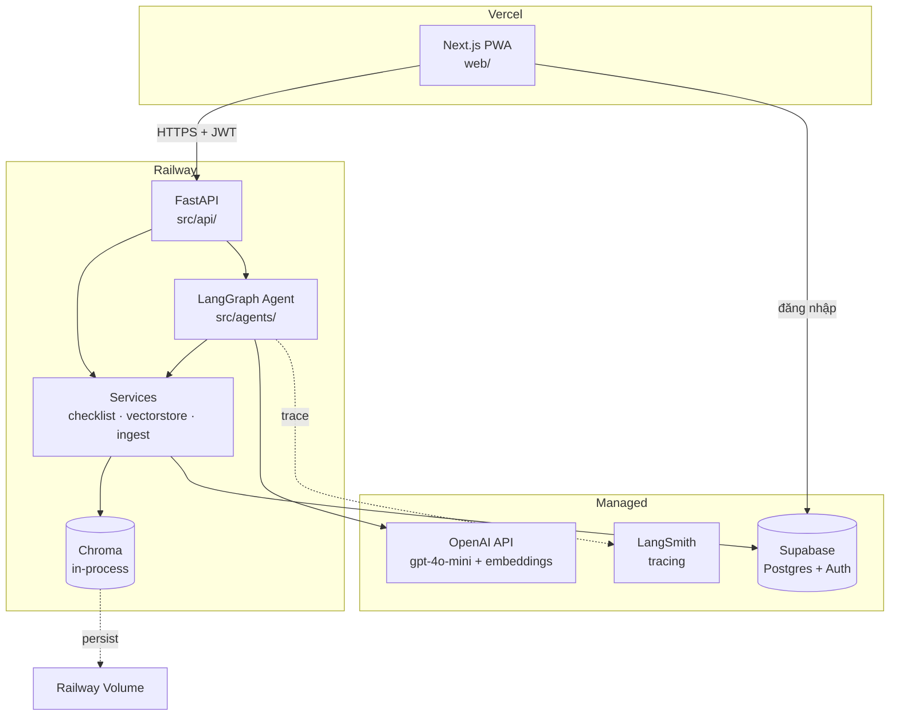
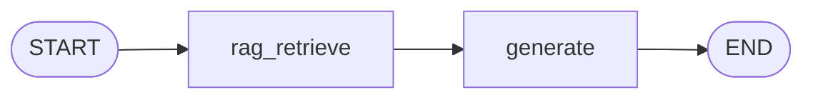
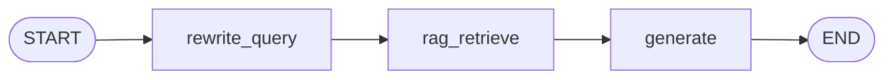
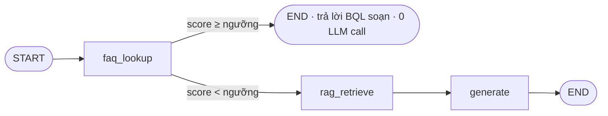
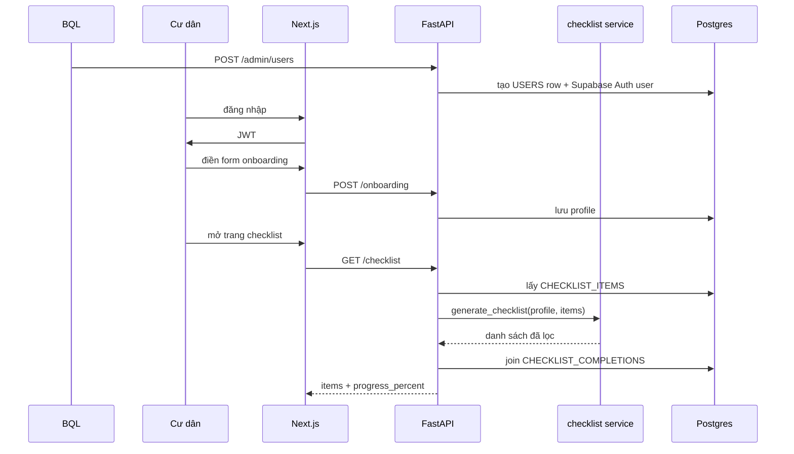
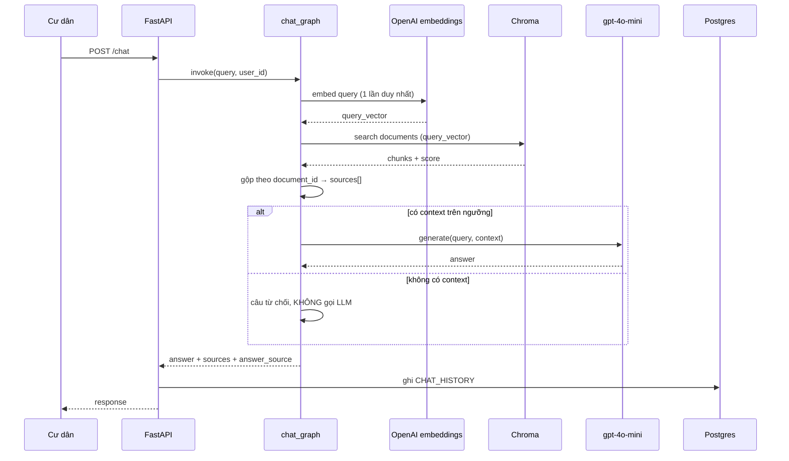
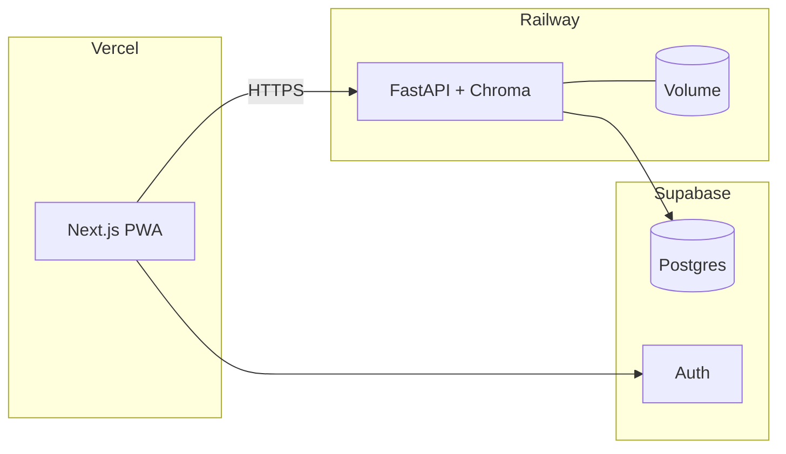

# Architecture — MoveInMate

> Kiến trúc hệ thống cho Phase 1. Nguồn quyết định về scope và persona: [`PROJECT_CHARTER.md`](./PROJECT_CHARTER.md).
> Nhãn **`[GATE 2]`** = bắt buộc xong trước 12/08. Nhãn **`[W4]`** = vẫn thuộc Phase 1 nhưng làm sau.

**Cập nhật:** 19/08/2026 (rà soát đồng bộ tài liệu ↔ mã nguồn, Task 22)

---

## 1. System Overview

MoveInMate là web app dạng PWA giúp cư dân mới hoàn thành thủ tục onboarding tại Vinhomes Smart City. Hệ thống gồm ba tầng: giao diện Next.js trên Vercel, API FastAPI trên Railway, và tầng dữ liệu Supabase Postgres kết hợp Chroma vector store.

Hai năng lực cốt lõi được xử lý bằng hai cơ chế khác nhau có chủ đích: **checklist cá nhân hóa** dùng rule engine tất định (không LLM), còn **hỏi đáp thủ tục** dùng LangGraph agent với RAG. Ranh giới này là quyết định kiến trúc trung tâm — xem mục 7.

## 2. Architecture Diagram



**Vì sao Chroma chạy in-process:** stack bắt buộc theo đề bài. Vì filesystem của Railway là ephemeral, embeddings được ghi vào **Railway Volume** mount tại `chroma_persist_dir` — nếu không, mỗi lần deploy là mất toàn bộ vector và phải embed lại (tốn phí API, đi ngược ràng buộc "tối ưu chi phí").

**Đã lên volume thật từ 18/08** (trước đó Chroma nướng thẳng vào image Docker — xem `DEPLOY.md`). Volume mới gắn thì rỗng; `src/services/chroma_seed.py` chép bản mồi từ `/app/data/chroma_seed` (Dockerfile chép sang từ `data/chroma/` lúc build) vào volume đúng một lần lúc khởi động nếu volume còn rỗng, không đè nếu BQL đã nạp tài liệu qua production.

## 3. Components

### 3.1 Frontend — Next.js PWA (`web/`)

- **Vai trò:** giao diện cư dân (mobile-first) và giao diện BQL (desktop)
- **PWA:** web app manifest + service worker + bộ icon → cài được vào màn hình chính, mở toàn màn hình. *Cách khai báo manifest tuỳ phiên bản Next.js đang dùng — kiểm tra tài liệu trong `node_modules/next/dist/docs/` trước khi code, xem `web/AGENTS.md`*
- **Giới hạn có chủ đích:** chỉ cache vỏ app và asset tĩnh. **Không** làm offline data sync — chat và checklist đều cần mạng, và sync offline là khối lượng lớn không nằm trong yêu cầu nào của đề bài
- **State:** React state cục bộ + fetch trực tiếp; không thêm thư viện state management cho quy mô này
- **Auth:** lấy JWT trực tiếp từ Supabase client, gắn vào header mọi request tới API

### 3.2 Backend — FastAPI (`src/api/`)

Routes ánh xạ 1-1 với user story, xem bảng hợp đồng API ở mục 4.3.

- **Xác thực:** dependency `get_current_user` verify JWT của Supabase, trả về user kèm `role`
- **Phân quyền:** route `/admin/*` thêm dependency kiểm tra `role == "admin"`. `role` lưu ở bảng `USERS`, tra DB mỗi request admin (một query, chấp nhận được)
- **Validation:** Pydantic schemas trong `models/schemas.py` — đây là hợp đồng API với FE, không được đổi ngầm

### 3.3 Rule Engine — `src/services/checklist.py`

Hàm thuần, không phụ thuộc DB hay LangGraph:

```python
def matches(profile: dict, conditions: dict) -> bool:
    """Item hiển thị nếu MỌI cặp key:value trong conditions khớp profile.
    conditions rỗng ({}) → luôn khớp."""

def generate_checklist(profile: dict, items: list) -> list:
    """Lọc danh sách item theo profile cư dân."""
```

- So khớp AND, exact-match trên `conditions` (JSONB). Với `amenity_packages` (multi-select), giá trị đơn hiểu là "nằm trong danh sách"
- **Không hỗ trợ OR hay so sánh khoảng** — chấp nhận có ý thức. Nếu phát sinh nhu cầu OR, thêm hai dòng dữ liệu thay vì làm engine phức tạp hơn
- Validate key của `conditions` phải khớp field hợp lệ của `USERS` khi seed, chặn lỗi gõ nhầm khiến item âm thầm không bao giờ khớp

**`item_type` không tham gia lọc** — nó không phải điều kiện, mà là nhãn quyết định cách hiển thị và hành vi:

| `item_type` | Hiển thị | Tick hoàn thành | HITL (Phase 2) | Nguồn trích dẫn |
|---|---|---|---|---|
| `bql_actionable` | Mục thủ tục bình thường | Có | Có | Tài liệu nội bộ BQL |
| `third_party_info` | Có nhãn "quy trình bên ngoài BQL" | Có — cư dân tự xác nhận | **Không** | Quy định pháp luật công khai |

Response của `GET /checklist` phải trả kèm `item_type` để FE hiển thị đúng — cư dân cần biết mục nào BQL xử lý được và mục nào phải tự làm ở cơ quan khác.

### 3.4 AI Agent — LangGraph (`src/agents/`)

**Chỉ một graph: `chat_graph`.** Checklist không đi qua LangGraph.

**Hình dạng graph ở `[GATE 2]`** — hai node, không có nhánh FAQ, single-turn (đã bị đảo ngược 13/08, xem ngay dưới):



**Hình dạng graph THẬT đang chạy (từ 13/08)** — thêm `rewrite_query` để hỗ trợ hội thoại multi-turn, vẫn chưa có nhánh FAQ:



**Hình dạng graph sau khi bổ sung FAQ ở `[W4]`** (vẫn chưa làm — `faq_lookup` chưa tồn tại trong `src/agents/`):



| Node | Đọc state | Ghi state | Trách nhiệm |
|---|---|---|---|
| `rewrite_query` **đã xong 13/08** | `query`, `chat_history[]` | `query` (viết lại) | Chỉ chạy khi `chat_history` không rỗng — viết lại câu hỏi mơ hồ ("còn phí thì sao?") thành độc lập ngữ cảnh bằng LLM. Lịch sử KHÔNG bao giờ vào thẳng `generate` — vẫn giữ bảo đảm chống bịa |
| `faq_lookup` **`[W4]`, chưa code** | `query` | `query_vector`, `faq_answer`, `faq_score`, `answer_source` | Embed query → search collection `faq` → so ngưỡng |
| `rag_retrieve` **`[GATE 2]`** | `query`, `query_vector?` | `query_vector`, `retrieved[]`, `sources[]` | Search collection `documents`, top-k |
| `generate` **`[GATE 2]`** | `query`, `retrieved[]` | `answer` | LLM chỉ viết văn xuôi từ context |

**Ai embed query:** ở `[GATE 2]` graph chỉ có `rag_retrieve` → node này tự embed. Khi bổ sung `faq_lookup` ở `[W4]`, node đó embed trước và ghi `query_vector` vào state; `rag_retrieve` thấy `query_vector` đã có thì **dùng lại, không embed lần hai**. Nhờ vậy mỗi câu hỏi luôn chỉ tốn đúng một lần embedding ở cả hai giai đoạn.

**Hai bảo đảm kỹ thuật quan trọng:**

1. **`sources[]` là output tất định của `rag_retrieve`**, không phải do LLM sinh ra. Yêu cầu "trích tài liệu" của đề bài do đó là bảo đảm kỹ thuật, không phụ thuộc vào việc prompt có được tuân thủ hay không. Sources được gộp theo `document_id` trước khi trả về, tránh lặp cùng một tài liệu nhiều lần.

2. **Guard chống bịa thông tin:** khi `retrieved` rỗng hoặc mọi score dưới ngưỡng, `generate` **không gọi LLM** mà trả câu từ chối kèm hướng dẫn liên hệ BQL. Đây là ràng buộc trong code, không phải lời dặn trong prompt.

**Multi-turn đã làm (13/08), không còn single-turn.** Quyết định gốc "single-turn ở Phase 1" (07/08) đã bị **đảo ngược** — xem `PROJECT_CHARTER.md` mục 7. `conversation_id` có giá trị thì `POST /chat` tiếp tục hội thoại cũ, `chat_graph` được cấp `rag_history_turns` (mặc định 3, `src/config.py`) lượt gần nhất để node `rewrite_query` viết lại câu hỏi mơ hồ ("còn thẻ xe thì sao?") thành độc lập ngữ cảnh trước khi truy xuất. Lịch sử chỉ vào bước viết lại, không vào thẳng `generate`.

**Nhà cung cấp model (cập nhật 11/08):**

| Vai trò | Model | Đường gọi | Cấu hình |
|---|---|---|---|
| Chat | `gpt-4o-mini` | **Mặc định gọi thẳng OpenAI** (đúng stack BTC); OpenRouter là lựa chọn thay thế | `CHAT_PROVIDER=openai\|openrouter` |
| Embeddings | `gemini-embedding-001` (Google, **3072 chiều**) | Google Generative AI | `EMBEDDING_MODEL` |

Tên model khác nhau giữa hai đường: OpenRouter cần tiền tố `openai/`, còn API OpenAI trả `400 invalid model ID` nếu có tiền tố. `get_chat_llm()` tự thêm tiền tố cho nhánh openrouter — `CHAT_MODEL` luôn để trần.

**Embeddings lệch stack BTC** (BTC nêu GPT-4o-mini, không nêu model embedding). Lý do lịch sử: quyết định gốc gọi chat qua OpenRouter, mà OpenRouter không có endpoint embeddings. **Cần mentor xác nhận trước mốc 17/08.**

**Trace:** LangSmith — **CHƯA TRIỂN KHAI tính đến 11/08**. Khối `LangSmith` trong sơ đồ mục 2 và dòng `Observability | LangSmith` trong README mô tả trạng thái mong muốn, không phải hiện trạng: `grep -rn langsmith src/` không ra kết quả. Bật bằng `LANGCHAIN_TRACING_V2`, `LANGCHAIN_API_KEY`, `LANGCHAIN_PROJECT` — LangChain tự đẩy trace, không phải sửa code.

Tình trạng đầy đủ của quan sát, guardrail và độ tin cậy: **[`OPERATIONS.md`](./OPERATIONS.md)**.

### 3.5 Vector Store — Chroma (`src/services/vectorstore.py`, `ingest.py`)

Hai collection:

| Collection | Nội dung | Giai đoạn |
|---|---|---|
| `documents` | Chunk từ tài liệu KB | `[GATE 2]` |
| `faq` | Câu hỏi thường gặp do BQL soạn | `[W4]` |

**Metadata mỗi chunk** — gắn trực tiếp với quyết định phạm vi quy trình trong charter:

```json
{
  "document_id": 12,
  "title": "Quy trình cấp thẻ cư dân",
  "source_type": "bql_internal"
}
```

`source_type` nhận **bốn** giá trị (cập nhật 11/08). Nhờ đó câu trả lời phân biệt được nguồn, đúng ràng buộc: thủ tục thuộc bên thứ ba chỉ được hướng dẫn theo quy định công khai, không mạo nhận là quy trình BQL.

| Giá trị | Nghĩa | Nhãn hiển thị ở FE |
|---|---|---|
| `bql_internal` | Tài liệu nội bộ BQL cấp | Tài liệu Ban quản lý |
| `public_regulation` | Văn bản pháp quy còn hiệu lực | Quy định pháp luật công khai |
| `unofficial_web` | Trang cộng đồng/bên thứ ba | Trang tham khảo (chưa xác minh với BQL) |
| `synthetic_demo` | **Quy trình nhóm tự dựng** cho demo, neo theo quy định thật | Quy trình mô phỏng (dữ liệu demo) |

`synthetic_demo` phải hiển thị nhãn mô phỏng ở UI. Trình bày dữ liệu tự dựng như dữ liệu thật trước doanh nghiệp là rủi ro uy tín, không phải chi tiết thẩm mỹ.

**Không đổi nguồn embedding khi đã có index.** Vector hiện tại là 3072 chiều (`gemini-embedding-001`). `text-embedding-3-large` của OpenAI **cũng 3072 chiều** — đổi sang nó mà không ingest lại thì Chroma **không báo lỗi kích thước**, vector chỉ nằm khác không gian và retrieval trả rác im lặng. Đổi nguồn embedding = bắt buộc ingest lại toàn bộ + hiệu chỉnh lại `rag_max_distance`.

**Chiến lược chia nhỏ tài liệu (chunking)** — đây là yếu tố quyết định chất lượng retrieval, quan trọng hơn cấu trúc graph:

- Ưu tiên cắt theo mục/tiêu đề nếu tài liệu có cấu trúc rõ
- Không có cấu trúc: ~500 token, overlap 50
- **Bắt buộc kiểm tra thủ công** 10 câu hỏi thật xem retrieval có lấy đúng đoạn không, trước khi tin vào pipeline. Chunk sai làm hệ thống trông như "AI kém" dù code đúng hoàn toàn

**Nạp tài liệu:** script CLI nạp hàng loạt (dùng cho mốc 17/08) + upload đơn lẻ chạy đồng bộ qua giao diện BQL, có giới hạn dung lượng file. **Không dùng `BackgroundTasks`** — task chạy nền mất im lặng khi container restart, là chế độ hỏng khó chẩn đoán.

### 3.6 Database — Supabase Postgres (`src/models/db.py`)

| Bảng | Vai trò |
|---|---|
| `USERS` | Hồ sơ cư dân + `auth_user_id` trỏ Supabase Auth. Không lưu password. **Có `account_status`** (`active`/`locked`, thêm 18/08) — kiểm ngay trong `get_current_user` nên áp cho mọi endpoint, không phải gắn từng chỗ. Tài khoản bị khoá vẫn đăng nhập được và nhận JWT hợp lệ; mọi lời gọi API sau đó mới trả 403 — chặn phía server, không đụng Supabase Auth |
| `CHECKLIST_ITEMS` | Template thủ tục, có `conditions` (JSONB) và `item_type` |
| `CHECKLIST_COMPLETIONS` | Chỉ lưu mục **đã hoàn thành**: `(user_id, checklist_item_id, completed_at)` |
| `CHAT_HISTORY` | Lịch sử hỏi đáp + `answer_source` + `sources` (JSONB). `question`/`answer` đã qua che PII (`src/services/pii.py`, thêm 19/08) trước khi ghi — điện thoại bị che ở `question` nhưng CỐ Ý giữ nguyên ở `answer` vì KB chứa hotline BQL công khai |
| `FAQ` | Câu hỏi thường gặp do BQL quản lý — bảng đã tồn tại nhưng chưa có route CRUD nào (US-09 còn mở) |
| `DOCUMENTS` | Metadata tài liệu + `embed_status` (`pending`/`processing`/`ready`/`failed`, thêm 19/08) — BQL nạp qua `POST /admin/documents`, embed chạy nền, FE poll trạng thái qua `GET /admin/documents` |
| `APPLICATIONS` | Hồ sơ nộp trực tuyến (US-13) + duyệt (US-10) — **đã migrate và chạy đủ vòng đời**, không còn ở Phase 2. Partial unique index chặn hai hồ sơ đang mở cho cùng một mục checklist (task 20) |
| `APPLICATION_ATTACHMENTS` | Ảnh/PDF minh chứng — metadata only, nội dung nằm ở bucket private Supabase Storage, đọc qua signed URL hết hạn ngắn |

Chi tiết field: xem mục 6 của [`PROJECT_CHARTER.md`](./PROJECT_CHARTER.md).

**Migration bằng Alembic + script seed** cho `CHECKLIST_ITEMS`. Không có seed thì mỗi thành viên một database khác nhau, demo chỉ chạy trên máy người viết.

## 4. Data Flow

### 4.1 Onboarding → Checklist (không qua LLM)



**Lọc trực tiếp, không chốt cứng danh sách.** Checklist được tính lại mỗi lần gọi thay vì ghi sẵn lúc onboarding. Ba lợi ích:

- BQL cập nhật thủ tục thì cư dân cũ **thấy ngay**, không cần logic đồng bộ
- Cư dân sửa hồ sơ (mua xe sau khi dọn vào) thì checklist tự cập nhật, không cần logic gộp dễ sai
- Không phát sinh câu hỏi khó "mục đã tick nhưng không còn khớp điều kiện thì xử lý sao"

Chi phí: lọc 20-30 mục mỗi request, không đáng kể.

### 4.2 Hỏi đáp



**Lưu ý:** embedding là lời gọi tới OpenAI, **không phải** Chroma tự embed. Cấu hình Chroma phải tắt embedding function mặc định của nó (mô hình local), nếu không sẽ dùng nhầm mô hình khác lúc index và lúc query — vector không cùng không gian, retrieval trả về rác.

### 4.3 Hợp đồng API — ranh giới BE ↔ FE

**Bảng dưới liệt kê đúng 23 route thật trong `src/api/routes.py`** (đã rà lại 19/08 — bản trước liệt kê `GET /api/v1/chat/history`, endpoint đó chưa từng tồn tại; route thật của US-07 là hai dòng `/chat/conversations*` bên dưới). `CRUD /api/v1/admin/faq` (US-09) bị bỏ khỏi bảng vì chưa có route nào — vẫn `[W4]`, còn mở.

| Method | Endpoint | US | Giai đoạn |
|---|---|---|---|
| POST | `/api/v1/onboarding` | US-02 | `[GATE 2]` |
| GET | `/api/v1/checklist` | US-04 | `[GATE 2]` |
| PATCH | `/api/v1/checklist/{id}` | US-04 | `[GATE 2]` |
| POST | `/api/v1/chat` | US-05 | `[GATE 2]` |
| GET | `/api/v1/profile` · PATCH | US-06 | `[GATE 2]` |
| GET | `/api/v1/chat/conversations` | US-07 | `[GATE 2]` |
| GET | `/api/v1/chat/conversations/{id}/messages` | US-07 | `[GATE 2]` |
| POST | `/api/v1/admin/users` | US-00 | `[GATE 2]` |
| POST | `/api/v1/applications` | US-13 | đã xong (15/08) |
| GET | `/api/v1/applications` | US-13 | đã xong |
| POST | `/api/v1/applications/{id}/attachments` | US-13 | đã xong |
| GET | `/api/v1/applications/{id}/attachments/{aid}/url` | US-13 | **mới (19/08)** |
| GET | `/api/v1/admin/applications` | US-13 | đã xong |
| PATCH | `/api/v1/admin/applications/{id}` | US-10 | đã xong (18-19/08) |
| PATCH | `/api/v1/admin/applications/{id}/attachments/{aid}` | US-13/D1 | đã xong |
| GET | `/api/v1/admin/residents/{id}` | — | **mới (19/08)** |
| PATCH | `/api/v1/admin/residents/{id}/status` | — | **mới (18/08)** |
| POST | `/api/v1/admin/residents/{id}/reset-password` | — | **mới (18/08)** |
| POST | `/api/v1/admin/documents` | US-08 | **mới (19/08)** |
| GET | `/api/v1/admin/documents` | US-08 | **mới (19/08)** |
| CRUD | `/api/v1/admin/faq` | US-09 | `[W4]`, chưa code |
| GET | `/api/v1/admin/dashboard` | US-12-mini | `[W4]`, đã xong |

**Cư dân chưa hoàn thành onboarding:** `GET /profile` trả `onboarding_completed_at = null`, FE dựa vào đó chuyển hướng sang `/onboarding`. `GET /checklist` cũng trả cờ `onboarding_completed` để FE không phải gọi hai lần mới biết có nên hiển thị danh sách hay không.

**Quy ước đã chốt khi rà soát API (08/08):**

| Điểm | Quy ước |
|---|---|
| `GET /checklist` trả tiến độ | Hai nhóm: `overall` (cư dân xem, gồm cả thủ tục bên ngoài) và `bql_scope` (BQL xem và dùng cho eval, chỉ `bql_actionable`) |
| `PATCH /checklist/{id}` | Trả về **toàn bộ checklist đã cập nhật**, không chỉ mục vừa sửa — FE cập nhật cả thanh tiến độ trong một lượt gọi |
| `PATCH /profile` | PATCH đúng nghĩa: mọi field tuỳ chọn, chỉ gửi phần muốn đổi. Body rỗng trả 400 |
| `POST /onboarding` gọi lại | Cập nhật hồ sơ nhưng **không ghi đè** `onboarding_completed_at` |
| `amenity_packages` | Danh sách đóng (`pool`, `gym`, `tennis`, `bbq`, `kids_area`), không phải chuỗi tự do — giá trị lệch phải báo 422 thay vì âm thầm làm mục tiện ích biến mất |

### 4.4 `POST /chat` — tín hiệu điều hướng nộp hồ sơ (thêm 10/08)

`ChatResponse` có thêm field tuỳ chọn `suggested_action`, do node `generate` phát ra khi LLM gọi tool `request_submission_navigation` (`src/agents/tools/navigation.py`) — tức là khi người dùng hỏi **cách nộp** hồ sơ cho một thủ tục cụ thể (khác với hỏi "cần giấy tờ gì"). Nếu câu hỏi mơ hồ về việc là thủ tục nào, model được prompt để hỏi lại trong câu trả lời thay vì gọi tool — đã kiểm chứng cả hai nhánh bằng gpt-4o-mini thật.

```json
{
  "answer": "Bạn có thể nộp hồ sơ đăng ký thẻ xe tại Ban quản lý. Bạn có muốn tôi đưa bạn tới đó không?",
  "sources": [...],
  "answer_source": "rag",
  "suggested_action": {
    "type": "navigate_to_submission",
    "procedure_name": "Đăng ký thẻ xe",
    "checklist_item_id": 6
  }
}
```

**Đo thực tế 11/08 — tool bắn không ổn định (2/4 cách hỏi):**

| Câu hỏi | Tool bắn? |
|---|---|
| "Cho tôi nộp hồ sơ thẻ cư dân" | ✅ |
| "Dẫn tôi đến chỗ nộp hồ sơ đăng ký thẻ xe" | ✅ |
| "Tôi muốn đăng ký thẻ xe" | ❌ |
| "Tôi cần làm thẻ cư dân, giúp tôi nộp hồ sơ" | ❌ |

Nghịch lý cần biết: **thêm dữ liệu định tuyến (`data/kb/bql/`) làm tool càng ít bắn**, vì LLM trả lời được "nộp tại quầy lễ tân tầng 1" bằng văn xuôi nên thấy không cần gọi tool. Đây là hệ quả trực tiếp của việc để LLM quyết định một việc tính tất định được — cùng loại lỗi mà `sources[]` đã tránh bằng cách không hỏi LLM. Hướng xử lý đề xuất: chạy `_match_checklist_item` **luôn luôn** trên câu hỏi, tool LLM hạ xuống thành tín hiệu bổ trợ; nhưng phải giữ được ý định gốc của tool (không gắn nút điều hướng cho câu hỏi thuần thông tin) — **cần thống nhất với vai AI trước khi sửa**.

`suggested_action` là `null` khi không phát hiện ý định nộp hồ sơ. `checklist_item_id` là `null` khi `procedure_name` (do LLM tự suy ra) không đối chiếu khớp được với đúng một mục trong checklist thật của người dùng (`_match_checklist_item` trong `src/api/routes.py`) — **FE phải tự ẩn nút điều hướng trong trường hợp này**, không điều hướng mù.

**Cập nhật 19/08 — hầu hết hàng dưới đây đã xong, bảng gốc (10/08) đã lỗi thời:**

| Việc | Vai trò | Trạng thái |
|---|---|---|
| Thêm `SuggestedAction` type + field `suggested_action` vào `ChatAnswer` (`web/lib/api.ts`) | FE | **Đã xong** |
| Hiện nút/CTA trong bong bóng chat khi `suggested_action.checklist_item_id` khác null (`web/app/chat/page.tsx`) | FE | **Đã xong** |
| Trang `/checklist` nhận `checklist_item_id` để cuộn tới + highlight đúng mục | FE | **Đã xong** (`web/app/checklist/page.tsx`) |
| Trang nộp hồ sơ thật (upload CCCD/hợp đồng, theo `checklist_item_id`) | BE + FE | **Đã xong (US-13, 15-19/08).** Đây chính là US-10/`APPLICATIONS` — dòng cũ ghi "đã xếp Phase 2, chưa migrate" không còn đúng, xem mục 3.6 và `PROJECT_CHARTER.md` mục 6-7 |
| (Tuỳ chọn) Lưu `suggested_action` vào `CHAT_HISTORY` | BE | **Vẫn chưa làm** — `ChatHistory` (`src/models/db.py`) không có cột này; xem lại lịch sử chat cũ sẽ không thấy `suggested_action` |

Cùng lúc, đối chiếu tất định `_match_checklist_item` mô tả ở trên **đã hết là "hướng xử lý đề xuất"** — nó chạy luôn luôn trên mọi câu hỏi kể từ 12/08 (không còn phụ thuộc việc tool LLM có bắn hay không), đúng như dòng chữ ở đoạn "Nghịch lý cần biết" phía trên đã đề xuất. Bảng đo 2/4 ở trên là số đo của LỚP TOOL LLM trước khi có lớp đối chiếu tất định — không còn phản ánh độ tin cậy thật của tính năng hiện tại.

## 5. Error Handling

Phân biệt rõ "lỗi hệ thống" và "không có dữ liệu" — nhầm hai loại này làm hệ thống hoặc bịa thông tin, hoặc báo lỗi sai chỗ:

| Tình huống | Phân loại | Hành vi |
|---|---|---|
| Chroma rỗng hoặc score dưới ngưỡng | Không phải lỗi | HTTP 200, câu từ chối kèm hướng dẫn liên hệ BQL |
| Gọi embedding thất bại | Lỗi hạ tầng | HTTP 503, không ghi `CHAT_HISTORY` |
| LLM `generate` lỗi/timeout | Lỗi một phần | Trả `sources[]` đã lấy được kèm ghi chú chưa tạo được tóm tắt |
| JWT sai/hết hạn | Lỗi xác thực | HTTP 401, FE chuyển về đăng nhập |
| Chưa onboarding | Không phải lỗi | `onboarding_completed_at = null` |

**Bắt buộc:** timeout tường minh cho mọi lời gọi ra ngoài (OpenAI, Supabase). Không timeout thì request treo vô hạn — lỗi kinh điển lúc demo. Không dùng `except:` trần; bắt đúng loại exception theo quy ước code style của dự án.

## 6. Testing

```
tests/
├── test_services/test_checklist.py   ← ưu tiên cao nhất
├── test_agents/test_chat_graph.py    ← mock vectorstore + LLM
└── test_api/test_routes.py           ← test DB riêng
```

**`test_checklist.py` là nơi đầu tư đáng giá nhất.** Hàm thuần, không cần mock, và nó bảo vệ đúng thứ tạo nên giá trị sản phẩm: cá nhân hóa. Checklist sai cho một persona thì luận điểm sản phẩm sụp, mà lỗi loại này rất khó phát hiện bằng mắt. Viết dạng bảng: mỗi tổ hợp `ownership_type × has_car × amenity_packages` kỳ vọng ra đúng danh sách nào.

**Test agent kiểm tra logic điều hướng, không kiểm tra chất lượng văn bản LLM:** trúng ngưỡng có bỏ qua LLM không, không có context có từ chối không, sources có gộp trùng không.

## 7. Design Decisions

| Quyết định | Lựa chọn | Lý do |
|---|---|---|
| Phân loại cư dân | Rule-based, **không LLM** | Persona là tập hữu hạn thuộc tính thu qua form có cấu trúc. Dùng LLM ở đây vừa tốn kém vừa kém tin cậy hơn |
| Vị trí rule engine | Service thuần, **không phải node LangGraph** | Một graph một node bọc hàm thuần là thừa. LangGraph dành cho chỗ cần quyết định thật: hỏi đáp và định tuyến ticket (Phase 2) |
| Nguồn của `sources[]` | Từ `rag_retrieve`, **không hỏi LLM** | Bắt LLM tự liệt kê nguồn là nơi phần lớn hệ RAG thất bại — bịa tên tài liệu, sai format |
| Lưu checklist | Lọc trực tiếp, chỉ lưu mục đã xong | BQL cập nhật thủ tục là cư dân cũ thấy ngay; không cần logic đồng bộ hay gộp |
| Số lần embed mỗi câu hỏi | Một lần, dùng lại vector | Embed hai lần cho cùng một câu là lãng phí chi phí và latency |
| Persist vector store | Railway Volume | Filesystem Railway là ephemeral; không có volume thì mỗi lần deploy phải embed lại toàn bộ KB |
| Ingest tài liệu | Đồng bộ + script CLI | `BackgroundTasks` hỏng im lặng khi container restart, khó chẩn đoán |
| Hội thoại | Multi-turn (đảo ngược quyết định single-turn gốc, 13/08) | Node `rewrite_query` viết lại câu hỏi mơ hồ dựa trên `rag_history_turns` lượt gần nhất của đúng hội thoại đang mở, chỉ vào bước viết lại — giữ nguyên bảo đảm chống bịa ở `generate` |
| Nhánh FAQ | Thiết kế sẵn, code ở `[W4]` | Chi phí thật nằm ở hiệu chỉnh ngưỡng, cần dữ liệu thật. RAG đơn thuần đã đủ thoả mãn yêu cầu đề bài |
| Đường gọi chat model (11/08) | **OpenAI trực tiếp** mặc định, OpenRouter tuỳ chọn | Đúng stack BTC nêu; key trả phí không dính giới hạn credit của free tier. Giữ chuyển đổi vì các thành viên có key khác nhau |
| Nguồn embedding (11/08) | Giữ Google `gemini-embedding-001` | Index 386 chunk đã embed bằng model này. Đổi = ingest lại + hiệu chỉnh lại ngưỡng; trùng số chiều với OpenAI large khiến lỗi không lộ ra |
| Dữ liệu quy trình BQL (11/08) | **Tự sinh, gắn `synthetic_demo`**, neo theo Điều 6/7/13 Quy chế + hotline/bảng phí công khai | Mentor gỡ ràng buộc dữ liệu thật (08/08). Nhãn riêng để không bao giờ lẫn với tài liệu BQL thật khi KB lớn dần |
| Số liệu phí trong dữ liệu tự sinh | **Chỉ trích nguồn công khai**, không tự đặt số | Số phí bịa bị người trong nghề phát hiện tức thì; thà ghi "theo bảng giá đơn vị vận hành" |

## 8. Deployment



**Biến môi trường:**

| Nơi | Biến |
|---|---|
| Vercel | `NEXT_PUBLIC_API_URL`, `NEXT_PUBLIC_SUPABASE_URL`, `NEXT_PUBLIC_SUPABASE_ANON_KEY` |
| Railway | `APP_ENV=production`, `DATABASE_URL`, `SUPABASE_URL`, `SUPABASE_ANON_KEY`, `SUPABASE_SERVICE_KEY`, `SUPABASE_JWT_SECRET`, `CHAT_PROVIDER`, `OPENAI_API_KEY`, `GOOGLE_API_KEY`, `CORS_ORIGINS`. **KHÔNG đặt `PORT`** — Railway tự cấp |

**Ràng buộc vận hành:** Chroma chạy trong cùng tiến trình FastAPI nên hệ thống chỉ chạy **một instance**. Scale ngang sẽ khiến mỗi instance có một bản vector store riêng biệt — không bật auto-scale.

**CI/CD:** `.github/workflows/ci.yml` chạy ruff + pytest. Code không pass ruff bị reject.

**Deploy thực tế (11/08):** backend chạy tại `https://moveinmate-api-production.up.railway.app`, deploy bằng **Railway CLI** chứ không qua GitHub — repo private thuộc org và **không thành viên nào có quyền admin** (`admin=false` cho cả ba), nên không cài được GitHub App. Hệ quả: không auto-deploy, mỗi lần cập nhật phải `railway up` từ PowerShell.

Chi tiết từng bước cho cả hai phía: **[`DEPLOY.md`](./DEPLOY.md)**.

## 9. Security

Đề bài đặt ràng buộc tường minh: *"bảo mật giấy tờ & thông tin cá nhân cư dân mới"*. Các quy tắc dưới đây phục vụ trực tiếp ràng buộc đó.

- Không commit khoá; toàn bộ secret qua biến môi trường
- Supabase Auth là nguồn xác thực duy nhất — hệ thống không tự lưu password
- Validate input bằng Pydantic ở mọi endpoint
- Route `/admin/*` kiểm tra `role == "admin"` phía server, không tin phía client
- CORS chỉ mở cho domain Vercel của dự án
- Truy vấn dữ liệu cá nhân (`CHAT_HISTORY`, `CHECKLIST_COMPLETIONS`, hồ sơ) phải lọc theo `user_id` **ngay trong câu truy vấn**, không lấy hết rồi lọc ở tầng ứng dụng hay phía client

**Quy tắc kiến trúc: không bao giờ đưa dữ liệu cá nhân cư dân vào vector store.** Chroma không có cơ chế phân quyền theo người dùng — mọi thứ đã index thì bất kỳ ai hỏi đúng câu đều truy xuất được. Vector store chỉ chứa tài liệu thủ tục dùng chung. Khi Phase 2 làm `APPLICATIONS` (CCCD, hợp đồng), tuyệt đối không embed các tài liệu này để "tìm kiếm cho tiện".

**Kiểm soát chi phí:** `llm_max_tokens` (mặc định 600) đặt cho mọi lời gọi LLM. Giới hạn tốc độ theo IP đã xong 19/08 (`src/services/rate_limit.py`): `/chat` 10/phút + 100/giờ, tải tệp/nạp tài liệu 20/phút — chặn burst từ một client, không phải trần theo người dùng mỗi ngày như bảng dự kiến ban đầu. **Cố ý không có trần tổng số request/ngày** trên toàn hệ thống: một trần như vậy mới thật sự bảo vệ được hạn mức Google 1000 request/ngày dùng chung cả nhóm, nhưng chạm ngưỡng giữa demo sẽ khiến trợ lý im lặng với mọi người — biến rủi ro bên ngoài thành sự cố tự gây ra. Hạn mức ngày vẫn là rủi ro được theo dõi thủ công, không phải rủi ro bị chặn bằng code — xem README mục "Giới hạn tốc độ".

## 10. Việc cần sửa trong code hiện có (bảng 07/08 — đã lỗi thời)

**Cập nhật 19/08: toàn bộ mục dưới đây đã xong.** `src/models/db.py` tồn tại và khớp mục 6/3.6; `web/app/login/page.tsx` gọi `supabase.auth.signInWithPassword` thật; `web/app/onboarding/page.tsx` tồn tại; các trang đã gọi API thật, không còn mock. Giữ bảng gốc lại làm mốc lịch sử (không xoá — xem git log nếu cần biết trạng thái Phase 1 lúc mới bắt đầu), nhưng đọc như tài liệu tham khảo, không phải việc còn tồn đọng.

| File | Việc (đã xong hết, xem trên) |
|---|---|
| `src/config.py` | `database_url` đang mặc định SQLite → trỏ Supabase Postgres; thêm biến Supabase, ngưỡng FAQ, `rag_top_k`, LangSmith |
| `src/models/db.py` | Chưa tồn tại — tạo model SQLAlchemy |
| `src/agents/nodes/example_node.py` | Code mẫu của template — thay bằng node thật |
| `src/agents/tools/example_tool.py` | Code mẫu — xoá nếu Phase 1 không dùng tool |
| `src/agents/state.py` | `AgentState` chung → `ChatState` với các field ở mục 3.4 |
| `web/app/login/page.tsx` | Đã kiểm tra: **không** có luồng tự đăng ký (đúng quyết định BQL cấp tài khoản). Nhưng nút "Đăng nhập" hiện là `<Link>` tĩnh sang `/dashboard` — cần nối Supabase Auth thật |
| `web/` | Thiếu trang `/onboarding` — mắt xích bắt buộc để checklist hoạt động |
| `web/` | Toàn bộ trang hiện dùng dữ liệu mock, chưa gọi API nào |

## 11. Rủi ro kỹ thuật đã biết

| Rủi ro | Mức | Giảm thiểu |
|---|---|---|
| Chất lượng chunking kém → retrieval trả về đoạn sai | Cao — hỏng thầm lặng | Kiểm tra thủ công 10 câu hỏi trước khi tin pipeline |
| ~~Xác thực JWT Supabase cấu hình sai~~ | **Đã xử lý 11/08** | Project ký **ES256**, verify bằng JWKS (`src/services/auth.py`). Bẫy đã tránh: dùng `SUPABASE_JWT_SECRET` (HS256) sẽ luôn thất bại |
| Chưa có tài liệu KB để demo ở GATE 2 (cổng dữ liệu là 13/08, **sau** GATE 2) | ~~Cao~~ Đã xử lý 08/08 | Quy chế kèm **Thông tư 05/2024/TT-BXD** (02/2016 đã hết hiệu lực 01/08/2024) + 7 trang thủ tục VSC. `source_type`: `public_regulation` / `unofficial_web` |
| Ngưỡng FAQ chưa hiệu chỉnh → không bao giờ trúng hoặc trúng sai | Trung bình | Để trong config; hiệu chỉnh bằng ~20 câu hỏi thật ở W4 |
| Chroma client là sync, node LangGraph là async → chẹn event loop | Trung bình | Bọc `run_in_threadpool` |
| **`data/chroma/` là DB nhị phân commit trong git** — chỉ đọc cũng làm bẩn working tree; `git checkout` nhầm là mất kết quả ingest | Trung bình — **đã xảy ra 11/08** | Quy ước một người ingest; kiểm `collection.count()` sau mọi thao tác git đụng `data/chroma/` |
| **Tool điều hướng bắn không ổn định** (2/4 cách hỏi, đo 11/08) | Cao cho demo | Lớp đối chiếu tất định ở BE; kịch bản demo chỉ dùng câu đã kiểm chứng |
| **Dữ liệu `synthetic_demo` bị trình bày như thật** | Cao cho uy tín | Nhãn xuyên suốt frontmatter → metadata → badge UI; nói minh bạch trong lời dẫn demo |
